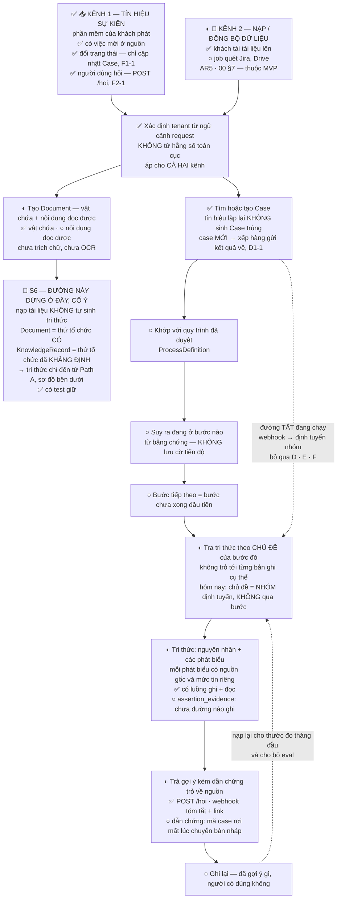
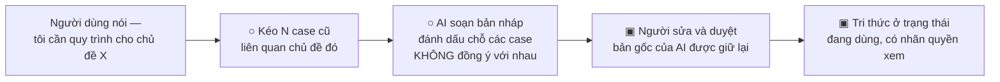
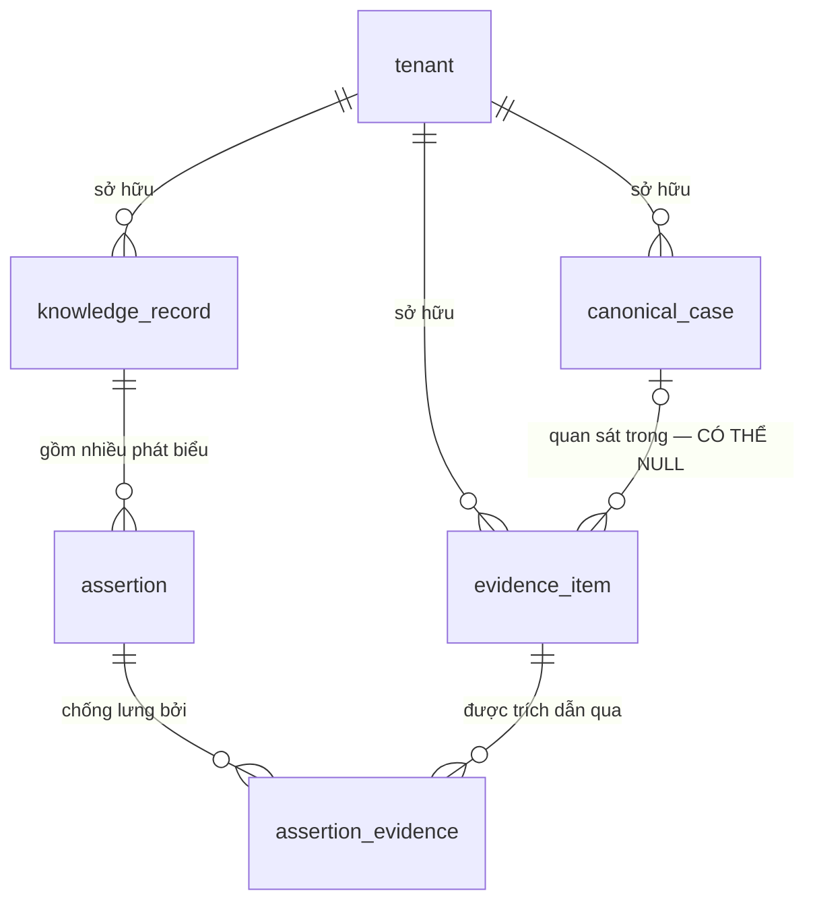
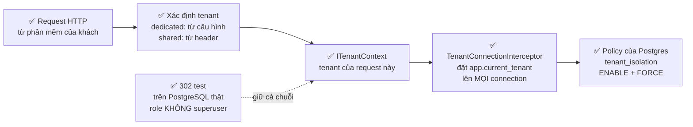

# AI Operational Knowledge & Process Platform

Nền tảng giúp doanh nghiệp đưa **đúng tri thức** và **đúng bước xử lý** đến đúng người,
đúng thời điểm — và khi tri thức chưa tồn tại thì giúp **tạo ra nó** từ dữ liệu vận hành
mà công ty đã có sẵn.

Đây không phải một ứng dụng người dùng đăng nhập vào. Nó là một service **phản ứng theo
sự kiện**: phần mềm có sẵn của khách (Jira, CRM, helpdesk...) phát tín hiệu, sản phẩm này
thức tỉnh, xử lý, và trả kết quả về.

Bên cạnh kênh tín hiệu đó còn một kênh thứ hai — **nạp / đồng bộ dữ liệu** (khách tải tài
liệu lên, job quét nguồn). Kênh này mang *vật chứa* vào, không mang *tri thức* vào: xem `S6`
trong sơ đồ dưới.

---

## ⚠ Đọc mục này trước khi đọc bất cứ thứ gì khác

```
Tài liệu thiết kế  ~17.000 dòng     27 quyết định domain + 35 quyết định khi code
Code                 ~6.300 dòng     nền móng · host · nạp tín hiệu + evidence ·
                                     vòng tri thức (nạp → duyệt → hỏi) · đường đọc
Test                 ~6.000 dòng     302 test, chạy trên PostgreSQL THẬT
Script vận hành      ~3.500 dòng     xuất Jira · kiểm corpus · dựng fixture ·
                                     gói duyệt · diff(A,B) · quét credential
```

**Tài liệu mô tả toàn bộ tầm nhìn. Code hiện có là phần nền móng của slice đầu tiên.**

Đừng đọc tài liệu rồi tưởng chức năng đã tồn tại. Xem [Đã build và chưa build](#đã-build-và-chưa-build)
để biết ranh giới thật.

**Giai đoạn hiện tại:** Workstream 07 — MVP Implementation, slice **Path A**
(gom nhiều case cũ thành một bản nháp quy trình, người sửa và duyệt).

**Mốc mới nhất — 2026-09-04: đã chạm vào DỮ LIỆU VẬN HÀNH THẬT, và nó dạy bốn thứ mà
dữ liệu bịa không dạy được.** Trước hôm nay mọi thứ đều xanh trên vật liệu do chính bộ
test dựng ra. Xuất 150 case Jira thật rồi nạp thử làm lộ ra: một **bug 500** ở đường nạp
(mốc thời gian `+07:00` — cả 103 test cũ không thấy vì tay người viết test luôn viết
UTC), một **trường phân loại là hằng số** (`machineReadability` = High ở 128/128), **ranh
giới khách sạn không có nguồn nào để thực thi**, và **credential sống trong 5,2% mẩu
evidence**. Chi tiết ở [Rủi ro đang mở](#rủi-ro-đang-mở).

⚠ Điểm chung của cả bốn: chúng **không crash** và **không đỏ test nào**. Chúng chỉ sai
im lặng — đúng loại lỗi mà cả dự án được dựng để chặn. Bộ test hiện có **302 test**, và
bài học đắt nhất hôm nay là *một bộ test tự cấp vật liệu cho mình chỉ kiểm được những
hình dạng mà người viết nghĩ ra.*

**Mốc trước — 2026-08-25:** đã có **đường nhận tín hiệu**. Phần mềm của khách gọi vào,
hệ thống tạo Case, và tín hiệu gửi lại không sinh Case trùng. Cộng với mốc hôm trước —
ranh giới giữa các công ty khách hàng đã đóng hết một vòng, từ request HTTP xuống tới
luật của database.
Chi tiết: [Ranh giới tenant](#ranh-giới-tenant--đã-đo-trên-database-thật).

---

## Chạy thử

```bash
# 1. Một lần cho mỗi máy: role kp_app + 3 database. Cần superuser.
psql -U postgres -h localhost -f scripts/dev-db-setup.sql

# 2. Build + tạo schema
dotnet build src/KnowledgePlatform.slnx
dotnet ef database update --project src/KnowledgePlatform.Infrastructure --connection "Host=localhost;Database=kp_dev;Username=kp_app;Password=123456"

# 3. Tạo công ty khách hàng cho máy dev
psql -U kp_app -h localhost -d kp_dev -f scripts/dev-seed-tenant.sql

# 4. Tạo khoá API cho bản deploy thật (AR-e).
#    Máy dev BỎ QUA được: appsettings.Development.json bật Auth:AcknowledgeUnauthenticatedApi.
dotnet run --project src/KnowledgePlatform.Api -- --tao-khoa dev-tenant "connector Jira"
#    -> in ra kp_<id>_<secret> ĐÚNG MỘT LẦN. Gửi kèm: Authorization: Bearer kp_...
#    Thu hồi: dotnet run --project src/KnowledgePlatform.Api -- --thu-hoi-khoa <id>

# 5. Chạy
dotnet run --project src/KnowledgePlatform.Api
```

Bỏ bước 3 thì app **từ chối khởi động** — cố ý. Một bản deploy riêng không tìm thấy
khách hàng của mình thì thà không chạy, còn hơn chạy bình thường mà không thấy dữ
liệu nào và không ai biết vì sao.

```bash
curl localhost:5119/health                     # tiến trình còn sống
curl localhost:5119/health/ready               # DB sống + ranh giới tenant còn nguyên
curl localhost:5119/internal/tenant-boundary   # ranh giới tenant, đo từ trong request
```

**Vòng tri thức — nạp → duyệt → hỏi** (2026-09-13). Đây là đường đi hết một vòng, chạy
được ngay trên máy dev, không cần credit API:

```bash
# 1. Nạp bản nháp SOP do máy sinh. Nó vào kho ở trạng thái Draft — nạp KHÔNG phải duyệt.
curl -X POST localhost:5119/knowledge/sop-draft \
     -H "Content-Type: application/json" \
     --data-binary @docs/ket-qua-phan-tich/may-sinh-phan-quyen-ky-hieu.json

# 2. Hỏi TRƯỚC khi duyệt -> phải ra KHÔNG BIẾT, dù định tuyến ĐÚNG nhóm.
curl -X POST localhost:5119/hoi \
     -H "Content-Type: application/json" \
     -d '{"maTicket":"ES-346039"}'
#    -> bietTraLoi: false · lyDoKhongBiet: "nhom-chua-co-sop-duoc-duyet"

# 3. Duyệt một bản ghi (lấy id từ response bước 1). S7: nội dung + quyền xem MỘT hành động.
curl -X POST localhost:5119/knowledge/<id>/approve \
     -H "Content-Type: application/json" \
     -d '{"nguoiDuyet":"tên bạn","phamViXem":"noi-bo","xacNhanDuLieuThuongMai":true}'
#    `xacNhanDuLieuThuongMai` thiếu hoặc false -> 400 (AR-n). Đó là LỜI KHAI của người
#    duyệt rằng đã soát dữ liệu thương mại của khách, KHÔNG phải một phép kiểm tự động —
#    loại dữ liệu đó không có hình dạng nào để bắt bằng luật.

# 4. Hỏi lại -> giờ mới ra hướng dẫn, kèm mức kiểm chứng của TỪNG phát biểu.
curl -X POST localhost:5119/hoi \
     -H "Content-Type: application/json" \
     -d '{"maTicket":"ES-346039"}'

# 5. Người support SỬA lại — bản B của M2. Bản gốc KHÔNG bị đè.
#    Lấy assertionId từ bước 6 bên dưới.
curl -X POST localhost:5119/knowledge/<id>/sua \
     -H "Content-Type: application/json" \
     -d '{"nguoiSua":"tên bạn","sua":[{"assertionId":"<assertion-id>",
          "noiDungMoi":"cách xử lý đúng","mucKiemChung":"Verified"}]}'
#    -> record tự thành NEEDS_REVIEW (V3 gắn cờ, KHÔNG rút khỏi /hoi)

# 6. Đọc lại CẢ HAI bản — đây là chỗ diff(A,B) của M2 đọc được.
curl localhost:5119/knowledge/<id>
```

⚠ **Đừng đọc bước 4 xanh thành "tính năng đã dùng được".** Bộ định tuyến đang cắm là bản
**TRA SẴN**: nó tra bảng kết quả đã đo ở [`docs/13`](docs/13_DINH_TUYEN_ISSUE_MOI.md), không
gọi model. Nó chứng minh **đường ống** chạy, không chứng minh độ chính xác — con số 84,1%
vẫn nằm ở `docs/13`, không nằm ở đây. Đầy đủ: [`docs/07`](docs/07_MVP_IMPLEMENTATION.md) §3 `IM-31`.

Cái thứ ba là cái đáng xem. Nó đếm bằng **SQL thô cố ý không có điều kiện tenant** —
nếu con số nhỏ hơn tổng số dòng thật trong bảng, nghĩa là database đang chặn hộ.

### Gửi tín hiệu vào (Kênh 1)

```bash
curl -X POST localhost:5119/signals/case-observed -H "Content-Type: application/json" -d '[
 {"sourceReference":"jira:ES-2001","subject":"Booking Traveloka không về PMS",
  "sourceCreatedAt":"2026-01-05T09:00:00Z","sourceResolvedAt":"2026-01-05T14:30:00Z"},
 {"sourceReference":"crm:deal/4471","subject":"Khách hỏi về tích hợp OTA"}
]'
```

```
{"received":2,"created":2,"results":[...]}
```

Gửi lại y nguyên thì `created` về `0` và `caseId` không đổi — **tín hiệu lặp lại
không sinh Case trùng**. Đây không phải tiện lợi mà là bắt buộc: bên gửi retry,
webhook gửi lại, job đồng bộ chạy lại. Nếu mỗi lần sinh một Case mới thì Path A đi
gom về sẽ đếm một việc thành mười, và không có gì báo.

`sourceReference` cố ý là **chuỗi tự do** — `"jira:..."`, `"crm:..."`, `"zalo:..."`.
`G1`: Case không phụ thuộc Jira, Jira Issue chỉ là biểu diễn ở nguồn ngoài. Không
field nào của hợp đồng này biết Jira là gì.

### Nạp evidence — và mã khách sạn là BẮT BUỘC

```bash
curl -X POST localhost:5119/signals/case-evidence -H "Content-Type: application/json" -d '[
 {"caseSourceReference":"jira:ES-2001","sourceReference":"jira:ES-2001#comment-7",
  "content":"Da kiem room mapping, khong thay lech",
  "machineReadability":"Medium","subTenantCode":"17468"}
]'
```

`subTenantCode` **bỏ trống là 400**, không âm thầm hiểu thành "chưa biết" (`AR-l`). Ba giá trị
có nghĩa khác nhau và **không gộp được**:

```text
"17468"                  mã khách sạn thật
"khong-xac-dinh"         bên gửi ĐÃ được hỏi và trả lời: chưa biết
"khong-thuoc-khach-san"  khẳng định không thuộc khách sạn nào — việc nội bộ, ezGolf,
                         hoặc một chuỗi nhiều cơ sở chưa tách được
(cột NULL trong DB)      mẩu nạp TRƯỚC luật này. Chưa ai từng được hỏi.
```

Response trả kèm `distinctSubTenantCodes` và `subTenantWarning`: **đếm số giá trị PHÂN BIỆT,
không đếm độ phủ.** Một lô phủ 100% mà chỉ có một giá trị thì vô dụng cho ranh giới khách
sạn — đó đúng hình dạng của `Mã khách sạn = -1.0` (32/32 case) và `machineReadability = High`
(128/128 mẩu), hai lần vấp trong cùng một ngày.

```bash
# Điều kiện MỞ LẠI của AR-l, hỏi được bằng một lượt gọi — kèm ô `canTro`
curl localhost:5119/internal/sub-tenant-coverage
```

⚠ `datDieuKienMoLai: true` **KHÔNG** có nghĩa gỡ được cổng. Đọc `canTro` trước: trên `kp_dev`
hôm nay nó nói **137/145 mẩu chưa khai**, trong khi hai mã phân biệt duy nhất đến từ đúng hai
dòng tạo ra lúc thử.

### Đánh dấu một mẩu đã bị NGƯỜI GỬI rút lại

```bash
curl -X POST localhost:5119/evidence/rut-lai -H "Content-Type: application/json" -d '{
 "khoaNguon":"jira:ES-346661#description",
 "nguoiDanhDau":"tên bạn",
 "lyDo":"Người gửi nói gửi nhầm nội dung, đoạn này là của case khác"}'
```

Ca thật: một mẩu giải thích nguyên nhân overbooking kèm hai mã booking OTA, và **16 phút sau**
chính người gửi viết *"bỏ qua giúp em, em gửi nhầm nội dung"* — trong một case về *lỗi không
sinh mã đặt phòng*. Từ lúc đánh dấu, mẩu đó **rời khỏi danh sách dùng được** của đường đọc và
**nội dung không đi ra nữa**, nhưng dấu vết (ai, lúc nào, vì sao) thì còn.

🛑 **Chỉ NGƯỜI đánh dấu được.** Hợp đồng tín hiệu không mang ba trường này, nên connector không
có cách nào tự suy từ câu chữ — suy từ câu chữ là đoán, trái `G6`/`AP3`. Đánh dấu lần hai trả
**409**: ghi đè sẽ xoá mất tác giả và lý do của lần đầu.

### Chạy test

```bash
dotnet test src/KnowledgePlatform.slnx     # 302 test, tự apply migration
```

Và một phép kiểm **thứ hai**, kiểm thứ khác hẳn — `dotnet test` **không thấy được** nó:

```bash
dotnet run --project src/KnowledgePlatform.Api    # cửa sổ khác
python scripts/kiem_dau_cuoi.py                   # gọi THẬT cả 22 endpoint
python scripts/kiem_hai_khach.py                 # NGHIỆM THU I2-1: dựng 2 khách từ 0

# VÒNG KHÔNG-CREDIT cho định tuyến: xuất -> dán cho một ngữ cảnh AI -> nạp về
dotnet run --project src/KnowledgePlatform.Api -- --xuat-dinh-tuyen dev-tenant D:/tmp/dt.json 50
dotnet run --project src/KnowledgePlatform.Api -- --nap-dinh-tuyen dev-tenant D:/tmp/kq.json "tên bạn"
# ⚠ Đây là CÁI NẠNG, không phải định tuyến tự động — mỗi lô ticket mới cần một lượt nữa.
curl http://localhost:5119/openapi/v1.json       # hợp đồng tích hợp, sinh từ code
                                                 # (app phải chạy Tenancy__Mode=SharedMultiTenant)
```

Bộ test kiểm **LUẬT** và tự dựng payload của chính nó — đúng đắn cho việc nó làm, nhưng nghĩa
là mọi **bên gửi thật** (hai script Python, bộ Postman, phần mềm của khách) nằm ngoài tầm nhìn
của trình biên dịch. `kiem_dau_cuoi.py` kiểm **HỢP ĐỒNG còn gọi được**, và mục `F` của nó chạy
chính `load_fixture.py` — thứ đã **chết 400 cả lô** một lần trong khi 302 test vẫn xanh.

Test chạy trên **PostgreSQL thật**, cố ý. Row-level security là tính năng của database;
test nó bằng in-memory provider là test một thứ khác rồi tự cho mình cảm giác an toàn.

```
⚠ ĐỪNG chạy app hay test bằng role `postgres` hay bất kỳ superuser nào.
  Superuser ĐI VÒNG QUA row-level security, kể cả khi bảng có FORCE.
  → RLS bằng KHÔNG, và mọi test cách ly tenant PASS GIẢ.
  Test đầu tiên trong bộ test kiểm đúng điều này và sẽ đỏ nếu bạn làm vậy.
```

Đổi database khác: đặt biến môi trường `KP_TEST_DB`.

```bash
# Sinh migration (không cần DB thật)
dotnet ef migrations add TênMigration --project src/KnowledgePlatform.Infrastructure

# Apply lên DB thật
dotnet ef database update --project src/KnowledgePlatform.Infrastructure   --connection "Host=localhost;Database=kp_dev;Username=kp_app;Password=..."
```

Công nghệ: **C# / .NET 10 + PostgreSQL**. Quyết định và lý do ở
[`docs/06_MVP_ARCHITECTURE.md`](docs/06_MVP_ARCHITECTURE.md).

---

## Luồng chạy khi có một tín hiệu

Sơ đồ này là **thiết kế**, không phải mô tả code hiện có.

> 🧭 Cần **sơ đồ luồng CODE** — một request đi qua file nào, theo thứ tự nào, dừng
> sớm được ở đâu — thì ở [`docs/08_CODE_MAP.md`](docs/08_CODE_MAP.md). Hai sơ đồ trả
> lời hai câu hỏi khác nhau và **sai vào hai thời điểm khác nhau**: cái ở đây sai khi
> thiết kế đổi, cái ở kia sai khi code đổi.

```
✅  chạy được — gửi request vào là nó làm việc, và có test giữ
▣  chỉ có HÌNH DẠNG DỮ LIỆU — bảng và ràng buộc đúng, nhưng chưa luồng nào gọi tới
◐  mới có một phần
○  chưa build
```

Phân biệt `✅` với `▣` là quan trọng: hai thứ đó dễ bị đọc thành một, và đọc thành
một chính là cái bẫy mà [mục đầu file](#-đọc-mục-này-trước-khi-đọc-bất-cứ-thứ-gì-khác)
đang cảnh báo.

> ⚠ **Mũi tên là thứ tự dữ liệu chảy LÚC CHẠY, không phải thứ tự BUILD.**
> Hai thứ này khác nhau. Slice đầu tiên không đi theo sơ đồ này mà đi theo
> [sơ đồ Path A bên dưới](#luồng-ngược--slice-đang-build) — lý do ở ngay dưới đó.

Thông tin ở đây rải trong ba tài liệu khác nhau (`06` §1, `05` §5, `04` §3B.1) nên nó
được vẽ lại ở đây cho gọn.

> 🔄 **Đối chiếu lại với code 2026-10-09 — ký hiệu đã TỤT LẠI SAU code, ngược chiều với cái
> bẫy ở đầu file.** Sáu ô đổi ký hiệu: `A` `◐→✅` (đổi trạng thái + người dùng hỏi, `IM-43`) ·
> `A2` `○→◐` và `K` `○→◐` (`IM-47`) · `G` `I` `○→◐` · `H` `▣→◐`. Ô `C` giữ `✅` nhưng bỏ dòng
> *"đường dừng ở đây"* (`IM-40`). Ô `D` `E` `F` `J` vẫn `○` — **không có dòng code nào** cho chúng.
> Mũi tên nét đứt `C ⇢ G` là đường TẮT đang chạy thật, không phải thiết kế: xem ghi chú
> *"Về đường tắt"* ngay dưới sơ đồ. Sai theo chiều này ít nguy hiểm hơn chiều ở đầu file,
> nhưng nó vẫn làm người đọc đi build lại thứ đã có.



**Về ô "tìm hoặc tạo Case" (`✅`)** — đường đi vào đã sống, nhưng nó **dừng ngay ở
đó**. Response của endpoint tín hiệu cố ý chỉ có ba trường (`received`, `created`,
`results`) và không có `suggestions: []` — một trường rỗng sẽ làm bên gọi tưởng các ô
sau đã tồn tại và chỉ đang không có gì trả về.

> ⚠ **Cập nhật 2026-10-09:** câu *"dừng ngay ở đó"* giờ chỉ còn đúng cho **response trả
> ngay**. Từ `D1-1` (2026-09-16, `IM-40`), case **MỚI** được xếp vào hàng đợi gửi kết quả
> về, và vòng quét nền dựng gói bằng **chính `HoiHandler`** của `/hoi` rồi `POST` sang đích
> của khách. Lập luận về `suggestions` bên trên **vẫn nguyên**: kết quả đi đường RIÊNG
> (webhook), không nằm trong response — nên response vẫn không được có trường đó.
> Gửi lại cùng tín hiệu (`IM-40`) và tín hiệu đổi trạng thái (`IM-43`) thì **không** xếp hàng.

**Về đường tắt `C ⇢ G` (`◐`)** — `D` `E` `F` chưa có một dòng code nào: không entity
`ProcessDefinition`, không suy bước. Nên hôm nay tri thức được tra theo **NHÓM định tuyến**
thay vì theo bước quy trình: ticket → nhóm → bản SOP **đã duyệt** của nhóm đó, kèm hai cửa
*KHÔNG BIẾT*. Đó là đường của Path A (SOP theo nhóm nguyên nhân), không phải đường của sơ đồ
này — đừng đọc ô `G` `◐` thành *"đã tra theo bước"*.

⚠ Bộ định tuyến cắm hôm nay chỉ **tra bảng** (bảng đã đo + kết quả người vận hành nạp qua
`--nap-dinh-tuyen`), không phân loại được ticket mới. Và đường webhook còn một chỗ lệch
khoá riêng — xem [Rủi ro đang mở](#rủi-ro-đang-mở).

**Về ô tenant (`✅`)** — ô đã đi hết một vòng từ request xuống database:

```
✅ ITenantContext là interface phải tiêm vào, không phải static
✅ RLS ở tầng DB + RlsGuard kiểm lúc khởi động — ĐÃ CHẠY THẬT, PASS
✅ app.current_tenant được đặt tự động trên MỌI connection mở ra
✅ tenant đọc được từ một request HTTP thật, ở CẢ HAI chế độ deploy
✅ cấu hình tenant sai = KHÔNG START ĐƯỢC, không phải chạy im lặng
   → có test giữ, ở cả ba tầng. Chi tiết bên dưới.
```

✅ ~~Còn một mảnh chưa xong, nhưng nó là câu hỏi **sản phẩm**, không phải code: ở chế
độ nhiều khách hàng dùng chung, **chưa quyết được cách xác thực người gọi**.~~ —
**ĐÃ GIẢI 2026-09-16** (`AR-e`, `IM-39`): khoá API theo từng khách, thu hồi riêng, và tenant
giờ đến từ **khoá đã kiểm**, không từ header người gọi tự điền. Xem [Rủi ro](#rủi-ro-đang-mở).

**Về `S6`** — đây là chỗ dễ hiểu nhầm nhất của sơ đồ. Tải tài liệu lên **không** làm hệ
thống có tri thức; nó chỉ làm hệ thống có *vật chứa*. Chi tiết: `04` §1.9.

---

## Luồng ngược — slice đang build

Khi khách **chưa có** quy trình nào trong hệ thống, luồng trên không có gì để chạy — và đó
là tình trạng ngày đầu ở khách hàng #0 (chỉ 10% quy trình là viết ra và tìm được; §8.1 đã đi
kiểm chứng thực tế và xác nhận **không có SOP viết**). Nên slice đầu tiên làm **đường ngược lại**:



Chênh lệch giữa **bản AI soạn** và **bản người duyệt** vừa là thước đo chính của tháng đầu,
vừa là nhãn cho bộ eval. Đó là lý do bản gốc không bao giờ bị ghi đè.

### Vì sao build đường này trước, không build kênh nhận tín hiệu trước

```
1  Không có gì để tải lên      §8.1 đã xác nhận khách #0 không có SOP viết
2  Kể cả có thì S6 chặn        nạp tài liệu ra Document, KHÔNG ra KnowledgeRecord
                               → build xong kênh nạp vẫn là 0 tri thức
3  Chỉ Path A đẻ được cái      nó có "hành vi khẳng định" (người duyệt) mà S6 đòi
   đầu tiên                    07 §1: "Cap 1 và Cap 2 không có gì để làm cho tới
                               khi Path A tạo ra thứ đầu tiên"
4  Ranh giới tenant đi trước   nhồi vào sau rất đắt: phải backfill TenantId, rà lại
   mọi thứ                     mọi truy vấn đã viết. D3 + G7. Nên RLS nằm trong
                               CHÍNH migration đầu tiên — không có khoảnh khắc nào
                               bảng tồn tại mà chưa được bảo vệ.
```

Nguyên tắc xếp thứ tự ở đây là **làm trước cái mà làm sau sẽ đắt**, không phải làm trước
cái đứng đầu mũi tên.

> ⚠ **Thứ tự này đã bị đổi một phần, có chủ ý — 2026-08-25.** Kênh 1 (ô "tìm hoặc tạo
> Case") được build **trước** hai ô `○` của Path A. Lập luận bên trên KHÔNG bị xoá vì
> nó vẫn đúng về Kênh 2 và về `S6`; nhưng nó **bỏ sót một điều**: Path A cần *"N case
> cũ"*, và trước Kênh 1 thì không có đường nào đưa case vào hệ thống cả. Endpoint tín
> hiệu vừa là đường chính thức lúc chạy, vừa là đường nạp case lịch sử — nên nó phục
> vụ hai việc, và lý do số 1 ("không có gì để tải lên") không áp cho nó.
>
> Lý do số 2 và 3 vẫn nguyên: **Kênh 2 vẫn chưa nên build**, vì `S6` chặn — nạp tài
> liệu ra `Document`, không ra tri thức.

---

## Hình dạng dữ liệu

Sáu bảng. Sơ đồ chỉ vẽ **quan hệ**, không liệt kê field — field thì đọc code, đó là bản thật.



Hai chỗ không hiển nhiên:

- **`assertion_evidence` là một bảng riêng, không phải quan hệ nhiều-nhiều trơn** — vì liên
  kết có thuộc tính của riêng nó: dẫn chứng này *chống lưng*, *phản bác*, hay chỉ là *ngữ cảnh*,
  kèm ghi chú kiểu *"14/20 case làm bước này"*. Chính chỗ này là lý do chọn cơ sở dữ liệu quan hệ.
- **`evidence_item.ObservedInCaseId` được phép NULL, và điều đó quan trọng** — một email của
  senior hay một tin Zalo không thuộc case nào. Với thực tế 60% tri thức nằm rải rác thì đó
  không phải trường hợp hiếm.

**Một tri thức không phải một khối văn bản.** Nó là một nguyên nhân, gồm nhiều phát biểu, mỗi
phát biểu tự mang nguồn gốc và mức tin riêng:

```
knowledge_record   "Parser dưới 2.3 bỏ qua payload OTA dạng X"
├── assertion  [nguyên nhân tồn tại]   nguồn: AI suy luận   tin: đã xác minh
├── assertion  [cách nhận ra]          nguồn: AI suy luận   tin: ⚠ MÂU THUẪN
├── assertion  [áp dụng cho]           nguồn: AI suy luận   tin: có chứng cứ
└── assertion  [cách xử lý]            nguồn: AI suy luận   tin: có chứng cứ
```

`MÂU THUẪN` là một giá trị hạng nhất, **không phải lỗi** và không phải "hơi tin". Khi gom 20
case, chỗ các case không đồng ý chính là chỗ người duyệt cần nhìn — nó cho phép duyệt trong
10 phút thay vì 2 giờ.

---

## Năm cơ chế cốt lõi — đây là toàn bộ giá trị của slice hiện tại

Cả năm nhắm vào cùng một loại lỗi: **lỗi thất bại im lặng**. Không crash, không báo, chỉ nằm
trong dữ liệu tới khi quá muộn.

| Rủi ro | Cơ chế chặn | Ở đâu |
|---|---|---|
| Tạo phát biểu mà không khai nguồn gốc | Trường bắt buộc, không có mặc định → **không biên dịch được** | [`Assertion.cs`](src/KnowledgePlatform.Domain/Knowledge/Assertion.cs) |
| Thêm bảng mà quên bảo mật tenant | Quét **hai chiều** lúc khởi động: mọi bảng đã khai phải có RLS đúng **biểu thức**, và mọi relation trong schema phải được khai hoặc miễn trừ kèm lý do → **không start được** | [`RlsGuard.cs`](src/KnowledgePlatform.Infrastructure/Persistence/RlsGuard.cs) |
| Lấy tenant từ biến toàn cục | Là interface phải tiêm vào, không phải static | [`ITenantContext.cs`](src/KnowledgePlatform.Domain/Tenancy/ITenantContext.cs) |
| Quên nói cho database biết đang phục vụ khách nào | Đặt tự động ở tầng connection, không có đường vòng | [`TenantConnectionInterceptor.cs`](src/KnowledgePlatform.Infrastructure/Persistence/TenantConnectionInterceptor.cs) |
| Lưu trạng thái đáng ra phải suy ra | Danh sách giá trị chỉ có 3 → vi phạm thành **hành động cố ý** | [`KnowledgeVocabulary.cs`](src/KnowledgePlatform.Domain/Knowledge/KnowledgeVocabulary.cs) |

Ranh giới giữa các công ty khách hàng có **hai lớp**, và thứ tự quan trọng:

```
Lớp 1  PostgreSQL row-level security   ← NGUỒN QUYỀN LỰC THẬT
       Database tự chặn, kể cả khi lập trình viên quên câu WHERE
Lớp 2  Bộ lọc của EF Core              ← chỉ là tiện lợi, KHÔNG phải ranh giới bảo mật
       Một câu SQL thô là đi vòng qua nó ngay
```

---

## Ranh giới tenant — đã đo trên database thật

Trước 2026-08-24, bằng chứng duy nhất là "SQL sinh ra trông đúng". Vấn đề: cái bẫy lớn
nhất của RLS làm nó **bật mà không chặn gì, và không báo** — đọc SQL không phát hiện được.

Giờ đường đi đã liền một mạch, và mỗi mắt được một test giữ:



**Một codebase, hai chế độ deploy** (`G13`) — khác nhau đúng một dòng cấu hình:

```
DedicatedSingleTenant   một bản deploy cho một khách hàng.
                        Tenant từ cấu hình. Database TÌNH CỜ chỉ chứa một khách.
                        → chế độ của khách hàng #0.
SharedMultiTenant       một bản deploy nhiều khách hàng.
                        Tenant từ header của request.
                        → chưa có xác thực, nên nó TỪ CHỐI KHỞI ĐỘNG trừ khi
                          được thừa nhận tường minh. Xem Rủi ro.
```

Không có đường code nào biết mình đang chạy chế độ nào — cả hai đi qua cùng một
`ITenantContext`. Đó là điều `G13` đòi, và nó chỉ giữ được nếu **không** rẽ nhánh
lúc đăng ký dịch vụ.

**Đo được gì:**

| Thử | Kết quả |
|---|---|
| Câu SQL thô cố ý quên điều kiện tenant | Chỉ thấy dữ liệu của đúng khách hàng đó |
| Ghi dữ liệu mang mã khách hàng khác | Postgres từ chối |
| Chưa xác định được khách hàng nào | Thấy **0 dòng**, không phải thấy hết |
| Connection lấy lại từ pool | Không thừa hưởng khách hàng của lượt trước |
| Thêm bảng mà quên bật bảo mật | `RlsGuard` ném, và chỉ rõ **tên bảng** |
| Hai khách hàng gọi cùng một API, cùng một tiến trình | Thấy hai bộ dữ liệu khác nhau |
| Gọi xen kẽ hai khách hàng nhiều lượt | Không lượt nào lẫn dữ liệu sang lượt khác |
| Cấu hình tenant sai hoặc thiếu | **Không start được**, kèm lời giải thích |

**Và quan trọng hơn: bộ test đã được chứng minh biết ĐỎ.** Test xanh mà không thể đỏ thì
không phải bằng chứng, nó chỉ là sự yên tâm.

```
Gỡ FORCE khỏi một bảng      → 5 test đỏ    (đúng cái bẫy im lặng của RLS)
Gỡ nullif khỏi policy       → 3 test đỏ    (đúng lỗi tìm được hôm nay)
Gỡ interceptor khỏi host    → 4 test đỏ    (và đúng 4 ca "hai khách hàng")
Trỏ test vào role superuser → test đầu đỏ  (bộ đo tự tố giác khi nó vô nghĩa)
```

**Hai thứ chỉ chạy thật mới thấy** — cả hai đều là lỗi im lặng, cả hai đã sửa:

```
1  Policy văng lỗi ép kiểu, không phải trả 0 dòng
   Sau một RESET — chuyện connection pool làm — biến session thành CHUỖI RỖNG,
   và ''::uuid ném lỗi. Không rò rỉ, nhưng thông báo lỗi không nhắc gì tới tenant
   nên người đọc đi tìm sai hướng. → sửa bằng nullif(...) ở migration thứ hai.

2  Superuser đi vòng qua RLS, KỂ CẢ khi có FORCE
   Chạy app hay test bằng `postgres` là RLS bằng không — và mọi test cách ly
   tenant PASS GIẢ. Đây là loại lỗi làm hỏng chính BỘ ĐO, nguy hiểm hơn loại 1.
   → role riêng kp_app (không superuser), và một test kiểm đúng điều này.
```

Lý do và bằng chứng đầy đủ: [`docs/07_MVP_IMPLEMENTATION.md`](docs/07_MVP_IMPLEMENTATION.md)
§3 (`IM-9`, `IM-10`) và §7.

---

## Đã build và chưa build

**Đã có** — 6 bảng, build sạch 0 cảnh báo, và bảo mật tenant đã **chạy thật**:

```
tenant · canonical_case · evidence_item · knowledge_record · assertion · assertion_evidence
        └───────────── 5 bảng sau đều có bảo mật tenant ─────────────┘
                        ✅ đã đo trên PostgreSQL 18.6, 9 test giữ
```

*(Khối trên là 6 bảng ĐẦU TIÊN. Đếm lại 2026-10-09: schema có **13** bảng — danh sách thật
là `ToTable` trong [AppDbContext.cs](src/KnowledgePlatform.Infrastructure/Persistence/AppDbContext.cs);
bảng nào cần RLS thì `RlsGuard` tự suy từ model, không viết tay.)*

Và một **project host** chạy được: `dotnet run`, cả hai chế độ deploy, trong đó có
**đường nhận tín hiệu** tạo Case. *(Dòng này từng ghi "4 endpoint"; đếm lại trong
`Program.cs` 2026-10-09 là **22** — danh sách thật: `GET /openapi/v1.json`.)*

**Chưa có:**

```
· Truy vấn "tìm N case cũ liên quan"           → việc kế tiếp. AR4: Postgres
                                                 full-text search trước
✅ Phần gọi AI soạn nháp quy trình         XONG 2026-09-08/10 — ISopDrafter + SoanNhapRunner
✅ Luồng duyệt                        XONG 2026-09-13 — POST /knowledge/{id}/approve
✅ Cửa cho một CÂU HỎI                XONG 2026-09-13 — POST /hoi + cổng KHÔNG BIẾT
✅ Đường nạp bản NGƯỜI SỬA (M2)       XONG 2026-09-13 — POST /knowledge/{id}/sua
                                      + GET /knowledge/{id} để đọc CẢ HAI bản
   (bốn dòng trên giữ lại để thấy chúng TỪNG thiếu — docs/07 §3 IM-31, IM-32)
✅ Đường TRẢ KẾT QUẢ VỀ (D1-1)        XONG 2026-09-16 — webhook ra, hàng đợi bền,
                                      ký HMAC, thử lại. docs/07 §3 IM-40
✅ Link xem tri thức (D5-3)           XONG 2026-09-16 — token có hạn, thu hồi được
✅ Hai loại tín hiệu còn lại của Kênh 1  XONG 2026-09-17 — POST /signals/case-status
                                      (F1-1) · người dùng hỏi = POST /hoi (F2-1). IM-43
◐ Kênh 2 — đường nạp/đồng bộ tài liệu  NẠP xong 2026-09-17 — POST /documents. IM-47
     (AR5)                            Còn: job quét nguồn · trích chữ · cổng che ·
                                      quét credential lúc nạp
✅ Bảng Document                      XONG 2026-09-17 — kp.document, CÓ RLS; nội dung ở
                                      kho file, DB chỉ giữ metadata (AR5)
   (ba dòng trên sửa 2026-10-09 — trước đó chúng ghi "chưa có" dù code đã có 3 tuần)
· Mắt xích assertion → evidence               → bảng có, KHÔNG đường nào ghi: mã case
                                                 của bản nháp SOP rơi mất ở
                                                 SopDraftToKnowledge. Chặn "dẫn chứng"
                                                 của /hoi và việc đối chiếu lời khai AR-n
· Ghi lại "đã gợi ý gì, người có dùng không"  → chưa có gì: webhook cố ý không lưu
                                                 payload, /hoi không ghi, link không đếm
· Phép ĐẾM diff(A,B) trên cả nhóm              → dữ liệu đã đủ (IM-32), thiếu phép đếm
· ProcessDefinition / ProcessRun               → thiết kế xong, chưa code
✅ Xác thực người gọi (AR-e)          XONG 2026-09-16 — khoá API theo TỪNG khách,
                                      thu hồi riêng. docs/07 §3 IM-39
✅ Test cho phần tri thức             ĐÃ CÓ — AssertionTests · KnowledgeRecordLifecycleTests
                                      · VongTriThucTests. Dòng cũ đã lỗi thời, sửa 2026-09-16
```

`canonical_case` chỉ có 5 field và đó là **cố ý**: mô hình đầy đủ có thêm 9 thành phần
(lịch sử sự kiện, người phụ trách theo thời gian, phân loại...), nhưng slice này chỉ cần
*tìm* và *gom* case.

---

## Rủi ro đang mở

| | |
|---|---|
| ⚠ **Đường TRẢ KẾT QUẢ VỀ đã chạy, nhưng thứ nó trả về vẫn là "không biết"** | ✅ **ĐÃ CODE 2026-09-16** (`IM-40`): webhook ra + hàng đợi bền + ký HMAC + thử lại, và đã chạy thật một vòng khép kín tới bên nhận. <br><br>🛑 **Nhưng định tuyến vẫn là bảng TRA SẴN** (`DinhTuyenTraSan`, đọc `dinh-tuyen-150-case.json`), nên mọi ticket MỚI đều rơi vào cửa `dinh-tuyen-khong-biet`. Lần chạy thật đã cho đúng kết quả đó — và nó là bằng chứng cơ chế đúng, KHÔNG phải bằng chứng tính năng dùng được. <br><br>→ Đường ống đã xong; **độ chính xác 84,1% vẫn nằm ở Python** và vẫn chờ credit. Đừng đọc "webhook chạy rồi" thành "khách sẽ nhận được hướng dẫn". |
| ⚠ **Webhook tra bảng định tuyến bằng khoá ĐẦY ĐỦ, bảng đã đo lưu khoá TRẦN — nên cả 150 ticket đã đo cũng ra "không biết" khi đi qua webhook** | Thấy 2026-10-09 lúc đối chiếu sơ đồ luồng với code — **đọc từ code, CHƯA chạy thật**. `WebhookSender` đưa khoá nguồn của case (`jira:ES-…`, đúng dạng connector Jira gửi vào) cho bộ định tuyến; `dinh-tuyen-150-case.json` lưu `ES-…`. Tra từ điển khớp chính xác, nên rơi vào `tra-san-khong-co-trong-bang`. Trong khi đó `/hoi` với `"ES-346039"` (ví dụ ở mục Chạy thử) thì định tuyến RA nhóm — **cùng một ticket, hai đường ra, hai kết cục**, và cả hai đều "chạy". <br><br>⚠ Kết quả người vận hành nạp qua `--nap-dinh-tuyen` thì **không** dính: đường đó lưu theo khoá nguồn của case, nên khớp. Chỉ phần rơi về bảng đã đo là lệch. <br><br>⚠ Test không thấy vì `WebhookGuiVeTests` tự dựng bảng có sẵn tiền tố `jira:` — đúng hình dạng *"bộ test tự cấp vật liệu chỉ kiểm được những hình dạng mà người viết nghĩ ra"* ở đầu file. <br><br>✅ **Không rò dữ liệu**: lệch về phía KHÔNG BIẾT, tức phía an toàn. Bảng đã đo vốn là cái nạng (`IM-45`), nên chủ dự án chọn **ghi lại, CHƯA sửa** (2026-10-09). Hướng sửa nếu mở lại: khi rơi về bảng đã đo thì tra thêm khoá đã bỏ tiền tố nguồn, kèm một test dùng khoá dạng `ES-…` như bảng thật. |
| ⚠ **Bí mật ký webhook lưu ở dạng ĐỌC LẠI ĐƯỢC** | Khác `ApiKey.SecretHash` có chủ đích: khoá API là thứ ta **kiểm** (so hash là đủ), còn bí mật này là thứ ta **ký bằng** — không hàm băm một chiều nào ký được. <br><br>⚠ Hệ quả phải canh: một bản dump database làm lộ mọi bí mật ký. Nâng lên mã hoá-tại-chỗ khi có secret store thật (`AR-i` mới chốt nhánh biến môi trường, chưa có store). <br><br>⚠ Và chưa có lệnh xoay riêng bí mật: đổi địa chỉ thì GIỮ bí mật cũ (cố ý — đổi cả hai cùng lúc làm mọi gói đang bay thành gói không kiểm được). |
| 🛑 **Dữ liệu vận hành thật mang theo bí mật SỐNG, và đó là MẪU HÀNH VI chứ không phải ca lẻ** | Đo trên corpus Jira thật 2026-09-04: **40 chỗ nghi credential trên 18/345 mẩu = 5,2%**, tức cứ ~19 mẩu evidence có một mẩu chứa thông tin đăng nhập. Phần lớn là cặp ID + mật khẩu Ultraviewer mà khách gõ thành hai tin nhắn liên tiếp; cộng hai JWT token và một mật khẩu tài khoản hoá đơn điện tử VNPT **còn sống** (nhà cung cấp trả `OK` hai lần trong chính mẩu đó). <br><br>⚠ Đây không phải sự cố của một ticket — đó là **cách support team làm việc**: xin Ultraviewer để remote vào máy khách. Nên không xử lý được bằng cách sửa vài mẩu; phải là luật chạy mỗi lần nạp. Đã có `scripts/jira-export/check_corpus.py` (trả mã thoát ≠ 0, cắm được CI). <br><br>⚠ **Lọc theo từ khoá cùng dòng KHÔNG dùng được** — đo được là bắt **11%**. Khách gõ ID rồi mật khẩu ở hai tin nhắn trần, còn chữ "Ultraview" nằm ở lượt nói TRƯỚC ĐÓ của nhân viên: bộ lọc mù, mà model đọc thì thừa ngữ cảnh để hiểu đúng. Luật theo BỐN HÌNH DẠNG thật đạt recall **100%** (13/13) với 0 lần ăn nhầm — nhưng đó là **cận trên**, vì luật được sửa theo chính corpus dùng để đo nó. (`AR-j`) |
| 🛑 **Một trường phủ 100% với MỘT giá trị duy nhất — đã vấp HAI LẦN trong một ngày** | `machineReadability` = `High` ở **128/128** mẩu evidence, và `Mã khách sạn` của Jira = `-1.0` ở **32/32** case. Cùng một hình dạng lỗi, và nó **tệ hơn trường rỗng**: trường rỗng thì ai cũng thấy là thiếu, còn trường phủ-100%-một-giá-trị thì *trông như đã có dữ liệu* — mọi phép kiểm "trường này có được điền không?" đều trả lời CÓ. Ai viết `WHERE machineReadability = 'High'` rồi báo "đã lọc rồi" thì vừa lọc xong 100% dữ liệu. <br><br>→ **Luật đã rút ra:** với mọi trường dùng làm ranh giới hay bộ lọc, **đếm số giá trị PHÂN BIỆT, không đếm độ phủ.** Một giá trị = coi như rỗng. (`AR-k`, `AR-l`) |
| 🛑 **Ranh giới khách sạn A ↔ khách sạn B chưa được thực thi, và hiện KHÔNG CÓ nguồn nào để thực thi** | **✅ Đây là QUYẾT ĐỊNH có ý thức từ 2026-09-07, không phải chỗ bị bỏ quên:** đã chốt nhánh *lùi* — nạp evidence không có sub-tenant, không thêm cột, và ghi rõ ở đây rằng ranh giới này **chưa được thực thi ở bất kỳ tầng nào**. Mở lại khi có một nguồn cho **≥2 giá trị phân biệt**, và phải mở lại **trước** lúc có luồng duyệt thật. <br><br>✅ **CHỐT 2026-09-15 nguồn để mở lại:** thêm một **trường BẮT BUỘC ở đường nạp** — bên gửi khai mã khách sạn. ✅ **ĐÃ CODE 2026-09-16** (`IM-35`): `subTenantCode` bắt buộc, bỏ trống là **400**, và ba trạng thái không gộp được — `NULL` (nạp trước luật) · `khong-xac-dinh` (đã hỏi, chưa biết) · `khong-thuoc-khach-san` (khẳng định không thuộc ai). <br><br>🛑 **CÓ TRƯỜNG KHÔNG PHẢI CÓ DỮ LIỆU — đo ngay hôm code xong trên `kp_dev`: 137/145 mẩu CHƯA KHAI.** Và mâu thuẫn đáng biết: nguồn mà quyết định chọn (*bên gửi khai*) **không tồn tại** cho connector Jira — `customfield_12710` là hằng số `-1.0` — nên lô export từ nguồn này có **0 giá trị phân biệt**. Đường nạp vì thế tự ĐẾM số giá trị phân biệt và **nói thẳng ra**, còn `GET /internal/sub-tenant-coverage` trả lời điều kiện mở lại kèm ô `canTro`. <br><br>⚠ **Cổng 409 KHÔNG được gỡ:** chế độ shared vẫn **TỪ CHỐI DUYỆT** — xem `IM-31`. Đó là TRÁNH, không phải GIẢI. <br><br>Hôm nay `tenant` = ezCloud, nên mọi khách sạn nằm chung một kho. Đã chốt rằng đây LÀ ranh giới bảo mật, nhưng đo trên Jira thật thì không trường nào dùng được: `Mã khách sạn` là hằng số `-1.0`, `Tên khách sạn / Resort` thì 25/32 rỗng và phần còn lại ghi tên **team**. <br><br>⚠ **RLS không cứu được kiểu rò này** — rò xảy ra ở khâu **xuất bản SOP**, không ở khâu truy vấn hàng: Path A gom evidence của nhiều khách sạn (đúng quyền, RLS xanh) rồi sinh một bản nháp được duyệt và hiện cho mọi người. Dữ liệu đi qua ranh giới bằng cửa chính. <br><br>⚠ Và ĐỪNG suy sub-tenant từ tiêu đề: chỉ 8/32 case có mã trong tiêu đề, và tên trong tiêu đề lệch với thân bài (`ES-346622` ghi "Mariha" nhưng email là `mirahhotel.sales@`). (`AR-l`) |
| ⚠ **Dữ liệu của BÊN THỨ BA: luật che mới chỉ biết MỘT hình dạng, và nó đo trên n=1** | ✅ **ĐÃ CODE 2026-09-16** (`AR-n` B2a, `IM-37`): `ThirdPartyRedactor` che khối `<NMua>` ở khâu **NẠP**, trước khi nội dung chạm database. Che theo **CẤU TRÚC** (vị trí trong cây XML) chứ không theo từ khoá — chuỗi `MST` trần xuất hiện ở 10/345 mẩu và phần lớn là **MST của chính khách sạn**, một định danh công khai cần GIỮ. <br><br>✅ **Che định danh, GIỮ số tiền** — có lý do đo được: nhóm SOP dày nhất (*Lệch cấu hình tiền/thuế*, 8 case, 63 mẩu) chẩn đoán bằng cách so từng cột tiền. Che số tiền cho "an toàn" là lần thứ **BA** một bộ lọc hợp lý vứt đúng phần có giá trị. <br><br>🛑 **Rủi ro còn lại:** trên **873 mẩu thật**, khối `<NMua>` xuất hiện ở **đúng MỘT mẩu**. Đủ để chứng minh loại dữ liệu này tồn tại, **không đủ** để nói luật phủ được bao nhiêu. Hình dạng thứ hai sẽ tới và nó sẽ không mang thẻ `NMua`. → Đừng đọc `thirdPartyRedacted: 0` thành *"mẩu này sạch"*; nó chỉ nghĩa là luật không thấy gì. (`AR-n`) |
| ⚠ **Dữ liệu THƯƠNG MẠI chỉ được chặn bằng một LỜI KHAI** | ✅ **ĐÃ CODE 2026-09-16** (`AR-n` B2b): duyệt mà thiếu `xacNhanDuLieuThuongMai` là **400**, và lời khai được **lưu cùng lượt duyệt**. <br><br>🛑 **Nhưng đó là LỜI KHAI, không phải phép kiểm.** Giá hợp đồng theo năm, hạn hợp đồng và ý định rời bỏ của một khách hàng (`ES-346608#comment-803265`) **không có hình dạng nào** để bắt bằng regex — đó chính là lý do nhánh này chọn NGƯỜI. Hệ thống không đối chiếu được, và **hôm nay còn không biết mẩu nguồn là những mẩu nào**: `assertion_evidence` có **0 dòng**. <br><br>→ Chỉ nâng được từ *khai* lên *đối chiếu được* khi có mắt xích assertion → evidence. (`AR-n`) |
| ⚠ **Dấu "người gửi đã rút lại" có chỗ chứa rồi, nhưng CHƯA AI ĐÁNH DẤU CÁI NÀO** | ✅ **ĐÃ CODE 2026-09-16** (`AR-m`, `IM-35`): ba cột + `POST /evidence/rut-lai`, và **chỉ người** đặt được — hợp đồng tín hiệu không mang ba trường đó nên connector không có đường nào tự suy từ câu chữ. <br><br>🛑 **Rủi ro còn lại nằm đúng ở chỗ đó:** tín hiệu này chỉ tồn tại khi có người bỏ công đánh dấu, và hôm nay **số mẩu được đánh dấu là 0**. Ca `ES-346661` vẫn nằm trong corpus không mang dấu hiệu gì. <br><br>⚠ Hôm nay chưa hỏng vì đoạn sai và câu đính chính nằm CHUNG một mẩu 1 916 ký tự, nên model đọc mẩu đó thấy luôn câu đính chính. Đó là **may**, không phải thiết kế — và cái may đó hết hiệu lực đúng vào ngày pipeline cắt transcript thành nhiều mẩu, thứ mà `AR-h` đang tạo áp lực phải làm (mẩu dài đè bẹp xếp hạng **29:1**). <br><br>✅ Điều ĐÃ đổi: giờ **mới được phép** chốt cách cắt transcript. Trước 2026-09-16 thì không, vì cắt rồi không ghép lại được. (`AR-m`) |
| ⚠ **"Đã xong" đi NGƯỢC với hàm lượng tri thức — bộ lọc tự nhiên nhất sẽ vứt đúng phần có giá trị** | Corpus 12 tháng có **100% case đã đóng** mà chỉ **1,6 mẩu dùng được mỗi case** — mỏng hơn corpus 4 ngày (2,5) vốn chỉ 22% đã đóng, và 25% case có **0** mẩu dùng được. Trên corpus nhỏ đã đọc kỹ: cả 7/7 case đã đóng chỉ ghi *hết triệu chứng* ("Done nhé" — 23 ký tự; một case đóng bằng đúng một tấm ảnh), còn nguyên nhân thật nằm ở case **CÒN MỞ**. <br><br>Lý do chạm vào **tiền đề sản phẩm**, không phải chất lượng corpus: bước kết luận không biến mất, nó **xảy ra ở nơi khác** — 6 case chuyển sang phiên remote desktop, 2 case "gọi khách không được", 1 case ghi thẳng *"như đã trao đổi qua điện thoại"*. Chính các mẩu credential ở trên là **biên lai** của những lần chẩn đoán không để lại chữ nào trong ticket. Trong 128 mẩu, Kibana — bước 1 của quy trình 5 bước — được nhắc **0 lần**. |
| ✅ ~~Đường nhận tín hiệu chỉ có một cái chốt tạm~~ — **ĐÃ THAY 2026-09-16** | Nó là endpoint **ghi**: không xác thực thì bất kỳ ai cũng bơm được Case giả vào dữ liệu khách hàng — không crash, không báo, chỉ làm sai kho tri thức và sai thước đo tháng đầu. Hiện có một khoá dùng chung (`Ingest:SignalApiKey`), và **thiếu nó là không start được**. Nhưng khoá dùng chung không phân biệt được khách A với khách B, không thu hồi theo từng khách, không chống replay. Nó là cái chốt trong lúc chờ `AR-e`, không phải câu trả lời. <br><br>✅ **ĐÃ CODE 2026-09-16** (`IM-39`): khoá dùng chung bị XOÁ, thay bằng `Authorization: Bearer kp_<id>_<secret>` — khoá theo TỪNG khách, thu hồi riêng, có tác dụng ngay không cần restart (đã đo trên app sống). <br><br>⚠ **Còn lại:** chưa chống replay, chưa giới hạn tần suất. `C1-1` chọn *"rẻ nhất mà giải đúng vấn đề"* và hai thứ đó không nằm trong vấn đề nó giải. |
| ✅ ~~Chế độ nhiều khách hàng dùng chung chưa có xác thực~~ — **ĐÃ GIẢI 2026-09-16** | Tenant đến từ header `X-Tenant-Key`, và chưa có gì kiểm người gọi có quyền dùng khoá đó — biết khoá là đọc được dữ liệu. Nên chế độ này **từ chối khởi động** trừ khi được thừa nhận tường minh bằng một cờ cấu hình. Cờ đó không bảo vệ gì; nó chỉ làm việc deploy một API chưa xác thực thành **quyết định** thay vì **sơ suất**. ✅ **CHỐT 2026-09-15: API key theo từng khách hàng**, thu hồi được riêng. ✅ **ĐÃ CODE 2026-09-16** (`IM-39`). Tenant giờ đến từ **khoá đã kiểm**, không từ header người gọi tự điền — `X-Tenant-Key` bị xoá hẳn, không giữ song song. <br><br>🎯 **Đây là cổng TRÁNH ĐẦU TIÊN của dự án được gỡ vì đã GIẢI:** cờ `AcknowledgeUnauthenticatedTenantHeader` đã bị xoá, vì không còn trạng thái *"chạy mà chưa xác thực"* để mà thừa nhận. <br><br>⚠ Ba cổng TRÁNH khác **vẫn còn và không được gỡ theo**: cổng 409 của `AR-l`, lời khai `xacNhanDuLieuThuongMai`, và luật che một-hình-dạng của `AR-n` B2a. (`AR-e`) <br><br>⚠ **Không chặn khách hàng đầu tiên** — bản deploy riêng lấy tenant từ cấu hình, không từ người gọi. |
| ⚠ **Hai cơ chế phía tri thức chưa bị thử phá** | 3 trong 5 cơ chế giờ có test (RLS guard, mắt xích tenant, và interface tenant). Hai cơ chế còn lại — bắt buộc khai nguồn gốc, và danh sách trạng thái chỉ có 3 giá trị — chỉ được **trình biên dịch** chặn. Chặn lúc biên dịch mạnh hơn test, nhưng nó không kiểm được cái mà nó không thấy: một nơi gọi truyền `Origin` **sai** vẫn biên dịch bình thường. Đó đúng là kiểu lỗi mà `AP3` gọi là im lặng nhất. |
| ⚠ **Đã từng có lỗ fail-open trong chính cơ chế canh gác — đã sửa 2026-09-01, nhưng còn dư chấn** | `RlsGuard` bản cũ chỉ hỏi *"bảng này có policy nào không"*, không hỏi policy đó **nói gì**. Policy của PostgreSQL gộp bằng **OR**, nên chỉ cần thêm một policy `USING (true)` là khách A đọc được dữ liệu khách B — **trong khi guard vẫn báo xanh**. Đã đo thật, câu SQL tái hiện nằm ở `07` §3 `IM-22`. Guard giờ đối chiếu biểu thức policy và quét cả view/materialized view; 6 test + 5 đột biến giữ. <br><br>⚠ **Dư chấn còn lại:** biểu thức policy giờ nằm ở **hai chỗ** — hằng số trong `RlsGuard` và câu SQL trong migration. Trùng lặp là cố ý (suy từ migration thì migration sai sẽ tự hợp lệ hoá chính nó), nhưng nó nghĩa là đổi policy phải đổi hai chỗ. <br><br>⚠ Và `/health/ready` cố ý dùng phép kiểm **nông hơn** startup, để deploy cuốn chiếu không rút cả đội tiến trình khoẻ ra khỏi luồng. Chiều "quên khai entity mới" vì thế chỉ được chặn **lúc khởi động**, không phải liên tục. |
| ✅ Chuỗi kết nối / mật khẩu DB — **ĐÃ CHỐT 2026-09-15: biến môi trường** `ConnectionStrings__Default` | Hình dạng đã có: host đọc từ `IConfiguration`, nên biến môi trường hoặc secret provider nào của .NET cũng cắm được mà không sửa code, và thiếu nó là không start được. Còn phải chọn dùng secret store nào (`AR-i` — tên cũ `AR-d`, đánh lại 2026-09-03 vì trùng số hiệu). |
| ⚠ **Mọi kết luận từ dữ liệu thật hiện đứng trên MỘT khách, MỘT nguồn** | Toàn bộ số đo của 2026-09-04/05 lấy từ Jira của ezCloud, chủ đề hoá đơn. Chúng dùng được để **thiết kế** và để **bác một giả định cũ không có bằng chứng** — nhưng KHÔNG dùng được để chốt kiến trúc, vì `G1` nói Jira là **connector** chứ không phải product boundary, và `G12` nói đặc điểm dữ liệu của một khách là **tham số** chứ không phải hằng số thiết kế. Một deal CRM có trường có kiểm soát (stage, giá trị, ngành); một ticket Jira là văn xuôi tự do — số đo trên cái này không mang sang cái kia. <br><br>🛑 **Phân biệt đã suýt bị làm mờ, ghi lại vì nó sẽ tái diễn:** dùng dữ liệu thật để **tìm lỗi trong code** thì n=1 là đủ (đó là phát biểu về *sự tồn tại* — một mẫu chứng minh được, và cách này đã trả về bug 500 timezone, trường phân loại hằng số, luật che chỉ bắt 11%, lỗi lấy mẫu). Dùng nó để **chốt kiến trúc** thì n=1 không đủ (đó là phát biểu về *phân bố*). Ngày 2026-09-05 một kết luận đã bị viết ở sai mức và phải hạ cấp — xem `07` §5 `R-K4`. |
| ✅ ~~Kết luận "không cần vector DB" đứng trên n=1~~ — **PHÉP ĐẾM ĐÃ CHẠY 2026-09-04/05** | Giả định *"5-10 loại nguyên nhân"* **đã bị bác**: đo được **~19 nhóm** (18-30) cho MỘT chủ đề. Và phép thử retrieval cho thấy tín hiệu văn bản chỉ **AUC 0,61** — FTS được 34% trong khi **đoán mù được 31%**. <br><br>⚠ Nhưng xem dòng ngay trên: đó là số đo trên **một khách, một nguồn**, nên nó là **phép đo**, không phải quyết định kiến trúc. Chi tiết: [`docs/09_RK4_DEM_NGUYEN_NHAN.md`](docs/09_RK4_DEM_NGUYEN_NHAN.md). |
| ⚠ **"Tìm văn bản lặp lại nhiều lần thì ra SOP" — đã bị bác bằng số, và bản nháp SOP đầu tiên cho thấy vì sao** | Đo trên cả 150 case: **115 cặp** case chia nhau một khối văn bản lặp **nguyên văn** ≥300 ký tự, và đúng **1 khối** trong đó chứa bước làm thật (91 là câu trả lời mẫu, 21 là nhắc việc tự động, 2 là form nội bộ). Độ chính xác của cách làm hiển nhiên nhất: **0,9%**. <br><br>✅ Nhưng chính khối đó là một phát hiện tốt: một SOP hoàn chỉnh có B1/B2 kèm nhánh điều kiện, **cùng một nhân viên gõ lại nguyên văn ở hai case cách nhau 21 ngày**. Tức *"10%"* của con số 10/30/60 không nằm trong tài liệu — nó nằm trong luồng ticket và trong bộ đệm copy-paste của một người. Với nhóm này, việc của Path A là **tìm lại và tái dùng**, không phải phát minh. <br><br>🛑 Và điều nặng nhất: bốn nguyên nhân của nhóm dày nhất có **triệu chứng khách kể trùng nhau**, lại **cùng kết thúc ở một trang quản trị** xuất hiện ở 3 nhóm nguyên nhân khác nhau. Thứ phân nhánh **không nằm trong văn bản** — nó là một bước kiểm phải THỰC HIỆN. Đó là cơ chế đứng sau con số AUC 0,61 ở hàng dưới. Chi tiết: [`docs/11_CAY_QUYET_DINH_SOP.md`](docs/11_CAY_QUYET_DINH_SOP.md). |
| ⚠ **Bộ lọc tự nhiên thứ hai sẽ vứt đi đúng phần có giá trị: "chỉ lấy phần khách đọc được"** | Dựng bản nháp SOP cho nhóm thứ hai (*NCC từ chối payload*, 10 case) thì **8/10 case ghi rõ bước kiểm** — tốt hơn nhóm đầu (4/10) — nhưng phần dày lên **nằm trọn ở các mẩu NỘI BỘ**: thread phản biện giữa triển khai và kỹ thuật, nơi người ta dán nguyên văn payload nhà cung cấp trả về. Một bộ lọc *"chỉ lấy phần khách đọc được"* — nghe rất hợp lý, vì đó là phần sạch và lịch sự — sẽ vứt đi **5/10 bước kiểm** của nhóm này. Đây là lần thứ hai một **bộ lọc tự nhiên** vứt đúng phần có giá trị, sau *"chỉ lấy case đã đóng"*. <br><br>🛑 Và một quan hệ không ai nhìn ra khi xếp SOP theo nguyên nhân: bước kiểm **đầu tiên** của nhóm này (xem mã lỗi trong Nhật ký kết nối) **bị chặn bởi đúng nguyên nhân của nhóm kia** (phân quyền) — khách nói thẳng: *"Đâu phải ai cũng có quyền vào mục cấu hình này đâu em"*. Hai nhóm độc lập về nguyên nhân lại phụ thuộc nhau khi thao tác. Chi tiết: [`docs/11` §9](docs/11_CAY_QUYET_DINH_SOP.md). |
| ✅ ~~Nhãn quyền xem để dạng chuỗi tự do~~ — **ĐÃ SIẾT 2026-09-15** | ✅ **CHỐT 2026-09-15:** ba giá trị `rieng-tu` · `noi-bo` · `toan-cong-ty`. <br><br>✅ **ĐÃ CODE cùng ngày:** enum ba mức, dạng lưu kebab, giá trị ngoài tập bị 400 kèm danh sách. 7 record `noi-bo` cũ đọc lại nguyên vẹn, **không cần migration**. <br><br>⚠ Dạng lưu là kebab chứ KHÔNG phải tên C# — dùng `HasConversion<string>()` cho "nhất quán" sẽ làm 7 dòng cũ không đọc được. (`AR-a`, `IM-34`) |

---

## Đọc tài liệu theo thứ tự nào

```
0  docs/10_CHUYEN_MAY.md              CHỈ khi đổi máy: dựng lại ngữ cảnh
1  docs/00_CURRENT_STATE.md            trạng thái + việc đang làm. ĐỌC TRƯỚC.
2  AGENT.md                            cách làm việc trong dự án, các guardrail
3  docs/PROJECT_CONTEXT.md             khảo sát + tầm nhìn sản phẩm
4  docs/Canonical Case Model v0.2.md   mô hình Case
5  docs/04_KNOWLEDGE_MODEL_V0.1.md     mô hình Tri thức — 23 quyết định
6  docs/05_PROCESS_MODEL_V0.1.md       mô hình Quy trình — 4 quyết định
7  docs/06_MVP_ARCHITECTURE.md         quyết định công nghệ
8  docs/07_MVP_IMPLEMENTATION.md       nhật ký quyết định phát sinh khi code
                                       §3 IM-9/IM-10 và §7 là phần mới nhất
9  docs/08_CODE_MAP.md                 sơ đồ luồng CODE. Mở repo lần đầu thì
                                       đọc cái này trước khi mở file .cs nào
10 docs/09_RK4_DEM_NGUYEN_NHAN.md      một loại vấn đề có bao nhiêu nguyên nhân
11 docs/11_CAY_QUYET_DINH_SOP.md       bản nháp SOP đầu tiên, dựng tay trên dữ
                                       liệu thật — hình dạng đầu ra của Path A
12 docs/13_DINH_TUYEN_ISSUE_MOI.md     một ticket vừa đến thuộc nhóm nào —
                                       84,1% vs đoán mù 11,4%, và ba chỗ phải đọc kỹ
13 docs/18_QUYET_DINH_MUC_3.md         20 quyết định để đi hết mức 3 (bán được cho
                                       khách thứ hai). ĐÃ ĐIỀN ĐỦ 2026-09-16, và nó
                                       chứa lộ trình 10 bước còn lại.
15 docs/20_CHAY_TREN_WINDOWS.md        hồ sơ deploy. ⚠ Nguồn sự thật là LỆNH
                                       `--kiem-cau-hinh`, file này chỉ giải thích VÌ SAO.
14 docs/19_HOP_DONG_TICH_HOP.md        ⭐ TÀI LIỆU CHO NGƯỜI NGOÀI. Viết cho người
                                       viết code ở phía bên kia, không phải cho nội bộ.
                                       Phần gọi VÀO: GET /openapi/v1.json (sinh từ code).
                                       File này chứa thứ OpenAPI không tả được — webhook
                                       GỬI RA, và cách kiểm chữ ký.
```

**Bốn file để ĐIỀN, không phải để đọc** (sinh 2026-09-15):

```
14 docs/14_QUYET_DINH_CHO_CHU_DU_AN.md   11 quyết định chờ chủ dự án, dạng tích ô.
                                          Nhóm A (3 câu) đang CHẶN việc tiếp theo.
15 docs/15_KHAO_SAT_VAN_HANH.md          7 câu cho người làm support: cách họ THẬT SỰ
                                          làm việc, so với cái ticket ghi lại được.
16 docs/16_GOI_DUYET_BAN_MAY_SINH.md     bản nháp SOP do MÁY sinh, để support sửa.
                                          Đây là vế B của M2 — sinh lại bằng
                                          scripts/jira-export/goi_duyet.py
17 docs/17_GOI_DUYET_LECH_TIEN.md        nhóm nguyên nhân THỨ BA (lệch tiền/thuế,
                                          8 case / 63 mẩu — vật liệu dày nhất trong
                                          19 nhóm). Gói này KHÁC hai gói trên: 6/8
                                          ticket CÓ ghi cách chẩn đoán, nên câu hỏi
                                          đổi từ "chúng tôi đoán sai chỗ nào" sang
                                          "xếp vậy có đúng thứ tự không, thiếu bước nào"
```

⚠ **`12` và `16` đã gửi đi rồi thì ĐỪNG sinh lại** cho tới khi có bản trả về — bản trong
repo phải là đúng bản người duyệt đang cầm. Cả hai hiện sinh lại ra y nguyên từng bit;
giữ như vậy.

Điền xong thì kiểm bằng `python scripts/doc_quyet_dinh.py <file>` — nó bắt hai lỗi mà mắt
hay bỏ qua: **tích hai ô** ở câu chọn một, và **dấu tích sai cú pháp** (trông như đã điền
mà máy không đọc ra).

**Lập trình viên mới:** `08` trả lời ba câu mà không file `.cs` nào trả lời được, vì
câu trả lời nằm *giữa* các file — thứ tự pipeline lúc chạy, bốn cửa chặn lúc khởi
động, và endpoint nào đòi khoá / đòi tenant.

**Đọc nhanh nhất:** `04` §3C.5 (hình dạng đầy đủ của một tri thức) và `06` §10
(6 ràng buộc dễ sai nhất).

⚠ **Bẫy cho người mới:** `AGENT.md` §1 yêu cầu đọc `docs/01_...`, `docs/02_PRODUCT_FOUNDATION_V1.md`,
`docs/03_...`. Tên file thật khác, và **`02_PRODUCT_FOUNDATION_V1.md` không tồn tại** — nó đã bị
mất cùng toàn bộ Success Metrics. Metrics đã được dựng lại ở `docs/02_SUCCESS_METRICS_V1.md`;
phần capability contract và non-goals thì vẫn mất.

---

## Quy tắc khi sửa file này

Dự án đã phải dọn 9 lần mâu thuẫn giữa các tài liệu nói về cùng một thứ, và bệnh "từ vựng
song song" tái phát 3 lần trong một workstream. Nên:

```
File này TRỎ ĐƯỜNG, không định nghĩa lại.
Từ vựng đã khóa nằm ở docs/04_KNOWLEDGE_MODEL_V0.1.md §3D.7 — tham chiếu DUY NHẤT.
Field cụ thể thì đọc code, đó là bản thật. Đừng chép field vào đây.
Sơ đồ vẽ bằng mermaid, không phải file ảnh — để thấy được trong diff khi nó sai.
```
