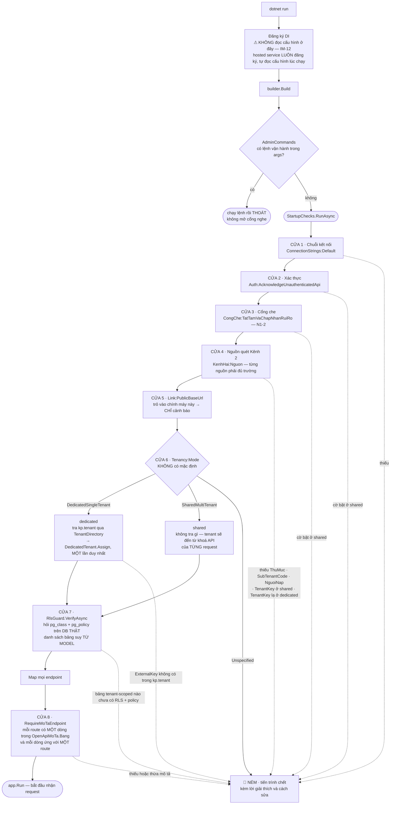
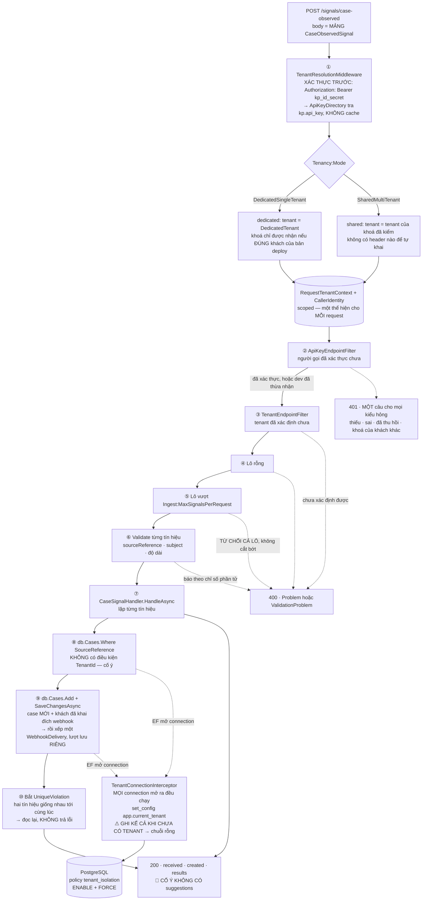
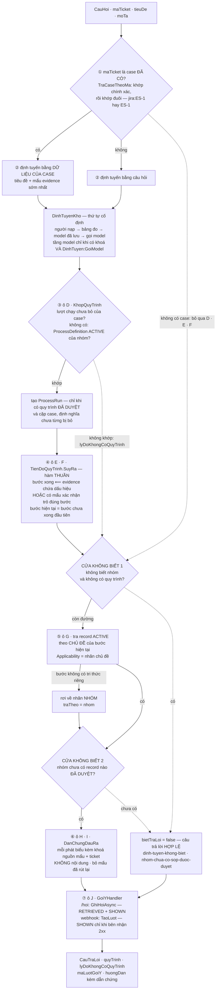
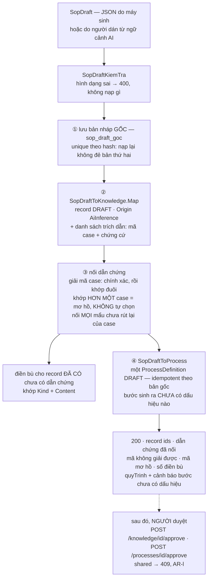
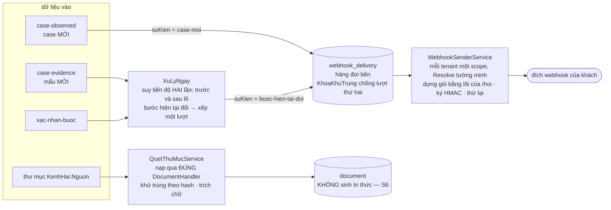

# 08 — Code Map

## Sơ đồ luồng CODE · bản đồ cho người mới mở repo

> **File này khác `README.md` §"Luồng chạy khi có một tín hiệu" ở đúng một điểm, và
> đó là điểm quan trọng nhất:**
>
> | | Vẽ cái gì | Sai khi nào |
> |---|---|---|
> | `README` §Luồng chạy | **Thiết kế** — nghiệp vụ muốn gì | Khi thiết kế đổi |
> | **File này** | **Code hiện có** — request đi qua file nào, theo thứ tự nào | Khi code đổi |
>
> Sơ đồ ở `README` có ô `○` cho thứ chưa build. **File này không có ô `○`.** Cái gì
> chưa build thì không nằm ở đây — vì đây là bản đồ để *đọc code*, và không đọc được
> thứ chưa tồn tại. Muốn biết còn thiếu gì thì xem `README` §"Đã build và chưa build".

> 🔄 **Vẽ lại 2026-10-10 (P10, `IM-49`).** Bản trước (2026-08-25) tả bốn cửa khởi động, một khoá dùng chung
> `X-Signal-Key` và bốn endpoint. Cả ba đã đổi: `SignalKeyEndpointFilter` bị xoá 2026-09-16 (`IM-39` — khoá
> theo TỪNG khách), cửa khởi động giờ là tám, endpoint là 33. Bản cũ vẫn đọc được:
> `git show 208577b:docs/08_CODE_MAP.md`.
>
> ⚠ Nó đã sai **im lặng** suốt ba tuần — không test nào đọc file này, nên không gì đỏ. Đúng kiểu sai mà
> mục cuối ("Quy tắc khi sửa file này") được viết ra để chặn, và quy tắc đó đã không đủ.

Lý do file này tồn tại: ba thứ dưới đây **không nằm trong file nào cả** — chúng nằm
*giữa* các file, nên "field thì đọc code" không cứu được.

1. Thứ tự pipeline lúc chạy, và mọi chỗ request có thể dừng sớm
2. Các cửa chặn lúc khởi động
3. Endpoint nào đòi khoá, endpoint nào đòi tenant, endpoint nào không đòi gì

---

# 1. Chuỗi khởi động — hỏng cửa nào cũng là KHÔNG START ĐƯỢC

Nguyên tắc của mọi cửa: **quên là không start được, không phải rò rỉ lúc chạy.**
Health check báo *sau* khi đã start — tức là có một khoảng thời gian ứng dụng chạy ở
trạng thái sai. Với ranh giới tenant (`G7` gọi là nền tảng) thì khoảng đó không được
tồn tại.



| Ô | File |
|---|---|
| Đăng ký DI, `builder.Build`, thứ tự gọi | [Program.cs](../src/KnowledgePlatform.Api/Program.cs) |
| Lệnh vận hành (`--tao-khach-hang` `--tao-khoa` `--thu-hoi-khoa` `--xuat-dinh-tuyen` `--nap-dinh-tuyen` `--xuat-soan-nhap` `--kiem-cau-hinh`) | [AdminCommands.cs](../src/KnowledgePlatform.Api/Startup/AdminCommands.cs) |
| Cửa 1–6 và cửa 8 | [StartupChecks.cs](../src/KnowledgePlatform.Api/Startup/StartupChecks.cs) |
| Bảng mô tả endpoint (cửa 8) | [OpenApiMoTa.cs](../src/KnowledgePlatform.Api/Startup/OpenApiMoTa.cs) |
| Tra `kp.tenant` | [TenantDirectory.cs](../src/KnowledgePlatform.Api/Tenancy/TenantDirectory.cs) |
| Giữ tenant của bản dedicated | [TenantResolutionMiddleware.cs](../src/KnowledgePlatform.Api/Tenancy/TenantResolutionMiddleware.cs) — class `DedicatedTenant` |
| Cửa 7 | [RlsGuard.cs](../src/KnowledgePlatform.Infrastructure/Persistence/RlsGuard.cs) |
| Danh sách bảng cần RLS | [AppDbContext.cs](../src/KnowledgePlatform.Infrastructure/Persistence/AppDbContext.cs) — `TenantScopedTables` |
| Soi cấu hình mà KHÔNG khởi động (`--kiem-cau-hinh`) | [SoiCauHinh.cs](../src/KnowledgePlatform.Api/Startup/SoiCauHinh.cs) |

**Cửa 7 là chỗ khó thấy nhất.** `TenantScopedTables` suy ra từ model bằng phản chiếu:
entity nào cài `ITenantScoped` là tự động vào danh sách. Nên thêm entity mới mà
migration quên bật RLS thì **không start được**, và thông báo chỉ đúng **tên bảng**.
Không có đường nào thêm bảng mà quên bảo mật.

**Cửa 8 phải đứng SAU mọi lệnh `Map*`**, và nhận `IEndpointRouteBuilder` chứ không phải DI — bản đầu lấy
danh sách route từ DI, lúc đó còn RỖNG, nên cổng duyệt một danh sách rỗng và **trông hệt như đang canh**.
Giờ nó kiểm cả hai chiều: danh sách rỗng làm mọi mô tả thành "thừa", nên cổng tự tố cáo khi bị ngắt lần nữa.

**Cửa 2 và cửa 3 cùng một hình dạng:** cờ hợp lệ ở dedicated (kèm cảnh báo mỗi lần khởi động), bị từ chối ở
shared. Ở shared, khoá API là thứ DUY NHẤT nói được request thuộc khách nào, và một bản shared mang dữ liệu
của nhiều công ty mà không công ty nào đã chấp nhận tắt cổng che.

**`DedicatedTenant` là chỗ duy nhất trong hệ thống có giá trị tenant sống lâu hơn một
request** — nên nó đóng lại được: `Assign` lần thứ hai là ném.

---

# 2. Một request đi qua đâu — ví dụ `POST /signals/case-observed`

Mọi endpoint sản phẩm đi qua **đúng ba mắt đầu** này (trừ `/xem/{token}`, xem §6). Đọc hiểu đường này là
hiểu được kiến trúc.



| Ô | File |
|---|---|
| Định tuyến, ④⑤⑥, thứ tự filter | [Program.cs](../src/KnowledgePlatform.Api/Program.cs) |
| ① | [TenantResolutionMiddleware.cs](../src/KnowledgePlatform.Api/Tenancy/TenantResolutionMiddleware.cs) · [ApiKeyDirectory.cs](../src/KnowledgePlatform.Api/Tenancy/ApiKeyDirectory.cs) |
| ② và `CallerIdentity` | [ApiKeyEndpointFilter.cs](../src/KnowledgePlatform.Api/Tenancy/ApiKeyEndpointFilter.cs) |
| ③ | [TenantResolutionMiddleware.cs](../src/KnowledgePlatform.Api/Tenancy/TenantResolutionMiddleware.cs) — class `TenantEndpointFilter` |
| `RequestTenantContext` | [RequestTenantContext.cs](../src/KnowledgePlatform.Api/Tenancy/RequestTenantContext.cs) |
| ⑦⑧⑨⑩ | [CaseSignalHandler.cs](../src/KnowledgePlatform.Api/Signals/CaseSignalHandler.cs) |
| Hình dạng body và response | [CaseObservedSignal.cs](../src/KnowledgePlatform.Api/Signals/CaseObservedSignal.cs) |
| Interceptor | [TenantConnectionInterceptor.cs](../src/KnowledgePlatform.Infrastructure/Persistence/TenantConnectionInterceptor.cs) |
| Query filter + schema | [AppDbContext.cs](../src/KnowledgePlatform.Infrastructure/Persistence/AppDbContext.cs) |

## Sáu chỗ dễ đọc sai trong sơ đồ trên

**`①` chạy như middleware, `②③` chạy như endpoint filter — và đó là hai giai đoạn
khác nhau của ASP.NET Core.** Middleware chạy cho **mọi** request kể cả `/health`;
endpoint filter chỉ chạy cho endpoint có gắn nó. Thứ tự thật là: *xác thực + phân giải
tenant (một chỗ, ①) → đòi đã xác thực (②) → đòi có tenant (③)*.

**`①` tra `kp.api_key` TRƯỚC khi có tenant, và đó là chủ đích chứ không phải lỗ.** `ApiKeyDirectory` cố ý
không dùng `AppDbContext`: `AppDbContext` cần `ITenantContext`, mà `ITenantContext` đang đợi chính lượt tra
này. Vòng tròn đó nói lên một điều thật — **việc xác thực nằm NGOÀI ranh giới tenant.** Không cache, vì cache
một khoá đã thu hồi là thu hồi không có tác dụng ngay.

**`①` KHÔNG chặn request thiếu tenant, và đó là chủ đích.** Hai lý do: `/health` phải
trả lời được khi chưa có tenant nào; và nếu một endpoint quên đòi tenant thì RLS vẫn
chặn — thấy **0 dòng**, không phải thấy hết (`IM-6`). Nên quên `③` không thành lỗ rò,
chỉ thành thông báo lỗi xấu.

**`⑧` cố ý không có `WHERE TenantId`.** Hai tầng lo việc đó: global query filter của
EF thêm điều kiện, và RLS chặn ở tầng DB kể cả khi filter bị đi vòng. Chỉ tầng thứ hai
mới là ranh giới bảo mật — một câu SQL thô đi vòng qua tầng thứ nhất ngay.

**`⑤` từ chối cả lô, không cắt bớt.** Cắt bớt im lặng đọc ra thành *"đã nạp hết"*
trong khi không phải — đúng loại thất bại im lặng mà cả dự án đang chống.

**`⑩` không phải trường hợp hiếm.** Kiểm-rồi-ghi không nguyên tử, nên unique index
`(TenantId, SourceReference)` là chốt cuối. Khi nó nổ, handler **đọc lại** và trả
`created: false` — bên gửi không làm gì sai.

**`OUT` thiếu `suggestions` vẫn là cố ý (`G11`), nhưng lý do đã đổi.** Bản 2026-08-25 nói *"các ô sau
chưa build"*. Giờ chúng đã có — và kết quả đi đường RIÊNG: `⑨` xếp một lượt gửi, vòng quét nền (§5) dựng
gói bằng chính lõi của `/hoi` (§3) rồi `POST` sang đích của khách. Một trường `suggestions` trong response
vẫn sẽ là nói dối: lúc response trả về thì chưa có gì được tra.

---

# 3. Một câu hỏi đi qua đâu — ô `D` → `J` của sơ đồ README

`POST /hoi` và webhook dùng **CHUNG một lõi** (`HoiHandler.HoiAsync`): một chỗ quyết định "biết hay không
biết", vì hai chỗ thì sẽ lệch nhau. Sau ba mắt ①②③ của §2:



| Ô | File |
|---|---|
| Endpoint, gọi lõi rồi ghi lượt gợi ý | [Program.cs](../src/KnowledgePlatform.Api/Program.cs) — `MapPost("/hoi"` |
| ① | [TraCaseTheoMa.cs](../src/KnowledgePlatform.Api/Signals/TraCaseTheoMa.cs) |
| ② | [DinhTuyenKho.cs](../src/KnowledgePlatform.Api/Knowledge/DinhTuyenKho.cs) · [DinhTuyenTraSan.cs](../src/KnowledgePlatform.Infrastructure/Sop/DinhTuyenTraSan.cs) · [AnthropicDinhTuyen.cs](../src/KnowledgePlatform.Infrastructure/Sop/AnthropicDinhTuyen.cs) · prompt: [DinhTuyenModel.cs](../src/KnowledgePlatform.Domain/Sop/DinhTuyenModel.cs) |
| ③ | [KhopQuyTrinh.cs](../src/KnowledgePlatform.Api/QuyTrinh/KhopQuyTrinh.cs) |
| ④ | [TienDoQuyTrinh.cs](../src/KnowledgePlatform.Domain/Process/TienDoQuyTrinh.cs) · entity: [ProcessDefinition.cs](../src/KnowledgePlatform.Domain/Process/ProcessDefinition.cs) |
| ⑤⑥, hai cửa KHÔNG BIẾT | [HoiHandler.cs](../src/KnowledgePlatform.Api/Knowledge/HoiHandler.cs) · nạp dẫn chứng tới tận mẩu: [TruyVanTriThuc.cs](../src/KnowledgePlatform.Infrastructure/Persistence/TruyVanTriThuc.cs) — `KemDanChung()` |
| ⑦ | [GoiYHandler.cs](../src/KnowledgePlatform.Api/GoiY/GoiYHandler.cs) · [LuotGoiY.cs](../src/KnowledgePlatform.Domain/GoiY/LuotGoiY.cs) |

## Năm chỗ dễ đọc sai trong sơ đồ trên

**`③` TẠO lượt chạy — đây là đường ĐỌC mà có ghi.** Hỏi về một case là dấu hiệu case đang được xử lý, nên
`/hoi` và webhook gọi `KhopAsync(taoLuotChay: true)`. `GET /cases/{khoaNguon}/quy-trinh` gọi cùng hàm với
`false` và không tạo gì. Lượt chạy đã bị NGƯỜI bỏ thì không bao giờ được dựng lại tự động.

**`④` không đọc cột tiến độ nào, vì không có cột nào** (`PR1`). Mỗi lần đọc là một lần suy lại từ evidence.
Lời xác nhận của người (`POST /quy-trinh/xac-nhan-buoc`) là một **mẩu evidence có tác giả**, `Origin =
UserConfirmed` — rút nó lại (`POST /evidence/rut-lai`) là bước tự thành chưa xong.

**Case đang chạy quy trình thì nhóm đến từ QUY TRÌNH, không từ định tuyến.** Lượt chạy giữ phiên bản nó bắt
đầu (`N6-1`), nên định tuyến lần này có nói khác cũng không đổi gì. Muốn đổi thì phải BỎ lượt chạy — việc mà
phản hồi `nhomDung` của §5 làm, bởi chính người khai.

**`⑥` không trả nội dung mẩu, cố ý.** Nội dung đọc qua `GET /cases/{khoaNguon}/evidence`, nơi luật rút lại
(`AR-m`) đã thực thi. Một đường đọc thứ hai cho cùng dữ liệu là đường sẽ quên luật.

**`⑦` ghi CẢ hai cửa KHÔNG BIẾT** — nấc `RETRIEVED` với `datDuoc = false`. Không ghi thì phễu của `M3` chỉ
đếm những lần hệ thống trả lời được, và tỉ lệ "được dùng" đẹp lên một cách giả.

---

# 4. Một bản nháp SOP đi vào kho — Path A

`POST /knowledge/sop-draft` là đường DUY NHẤT sinh tri thức (`S6`: tài liệu không sinh tri thức).



| Ô | File |
|---|---|
| Điều phối ①–④ | [SopDraftIngestHandler.cs](../src/KnowledgePlatform.Api/Knowledge/SopDraftIngestHandler.cs) |
| Kiểm hình dạng | [SopDraftKiemTra.cs](../src/KnowledgePlatform.Domain/Sop/SopDraftKiemTra.cs) |
| ② | [SopDraftToKnowledge.cs](../src/KnowledgePlatform.Domain/Sop/SopDraftToKnowledge.cs) |
| ④ | [SopDraftToProcess.cs](../src/KnowledgePlatform.Domain/Process/SopDraftToProcess.cs) |
| Duyệt tri thức · cổng 409 dùng chung | [KnowledgeApprovalHandler.cs](../src/KnowledgePlatform.Api/Knowledge/KnowledgeApprovalHandler.cs) · [CongDuyetARl.cs](../src/KnowledgePlatform.Api/Knowledge/CongDuyetARl.cs) |
| Duyệt / sửa bước / bỏ lượt chạy | [QuyTrinhHandler.cs](../src/KnowledgePlatform.Api/QuyTrinh/QuyTrinhHandler.cs) |
| Soạn nháp bằng model (có trần tháng, biên lai trước khi gọi) | [SoanNhapHandler.cs](../src/KnowledgePlatform.Api/Knowledge/SoanNhapHandler.cs) · [AnthropicSopDrafter.cs](../src/KnowledgePlatform.Infrastructure/Sop/AnthropicSopDrafter.cs) |

⚠ **`④` sinh bước KHÔNG có dấu hiệu nào**, nên bước chỉ xong bằng lời xác nhận của người cho tới khi người
duyệt thêm dấu hiệu lúc quy trình còn DRAFT (`PUT /processes/{id}/buoc`). ACTIVE thì bất biến (`N5-1`):
sửa là tạo phiên bản mới.

---

# 5. Việc chạy nền và việc "nhận về là xử lý luôn"

Ba thứ chạy **không** do một request trả lời trực tiếp:



| Ô | File |
|---|---|
| Xếp lượt khi case mới | [CaseSignalHandler.cs](../src/KnowledgePlatform.Api/Signals/CaseSignalHandler.cs) |
| Mẩu mới → `XuLyNgay` | [CaseEvidenceHandler.cs](../src/KnowledgePlatform.Api/Signals/CaseEvidenceHandler.cs) · [QuyTrinhHandler.cs](../src/KnowledgePlatform.Api/QuyTrinh/QuyTrinhHandler.cs) |
| `XuLyNgay` | [XuLyNgay.cs](../src/KnowledgePlatform.Api/QuyTrinh/XuLyNgay.cs) |
| Vòng quét gửi, phạm vi tenant, chữ ký | [WebhookSender.cs](../src/KnowledgePlatform.Api/Webhooks/WebhookSender.cs) · hình dạng gói: [WebhookPayload.cs](../src/KnowledgePlatform.Api/Webhooks/WebhookPayload.cs) |
| Quét thư mục, trích chữ | [QuetThuMuc.cs](../src/KnowledgePlatform.Api/Documents/QuetThuMuc.cs) · [DocumentHandler.cs](../src/KnowledgePlatform.Api/Documents/DocumentHandler.cs) · [TrichChu.cs](../src/KnowledgePlatform.Domain/Documents/TrichChu.cs) |

**Bốn chỗ `XuLyNgay` cố ý KHÔNG xếp lượt:** case chưa có lượt chạy · case đã xong ở nguồn · đã có một lượt
đang chờ (lượt đó dựng gói LÚC GỬI nên tự mang bước mới nhất) · khoá chống trùng (lượt chạy + bước) đã có.
`case-status` thì không xếp gì cả (`F1-1`, có test giữ).

**Bản dedicated chỉ quét ĐÚNG tenant của nó**, kể cả khi database tình cờ chứa nhiều tenant — lỗi thật tìm ra
bằng phép nghiệm thu hai khách (`I2-1`). Cả hai vòng nền dùng chung luật đó.

**Tiến trình nền không có middleware**, nên tenant được đặt tường minh bằng `RequestTenantContext.Resolve` —
chỗ duy nhất ngoài middleware gọi hàm đó, và vẫn đi qua đúng `ITenantContext` ấy, nên interceptor và RLS phía
dưới không biết mình đang ở đâu.

**Phản hồi `POST /goi-y/{id}/phan-hoi` kèm `nhomDung` là vòng `J ⇢ G`:** ghi `DinhTuyenDaNap` cho case (người
nạp thắng bảng đo), và nếu case đang chạy quy trình của nhóm CŨ thì BỎ lượt chạy đó, ghi tên người khai.

---

# 6. Bốn mươi thao tác — cái nào đòi gì

**Ba loại cửa, không có loại thứ tư:**

| Cửa | Endpoint |
|---|---|
| Không đòi gì | `GET /health` · `GET /health/ready` (chạm DB: kiểm RLS còn nguyên trên DB **đang chạy**) · `GET /openapi/v1.json` (tả HÌNH DẠNG hợp đồng, không chứa dữ liệu khách) |
| Chỉ token trong URL — `LinkTokenEndpointFilter` | `GET /xem/{token}` — hết hạn · thu hồi · sai đều `404` giống hệt nhau |
| `ApiKeyEndpointFilter` → `TenantEndpointFilter` | **mọi endpoint còn lại** — bảng dưới |

| Nhóm | Endpoint | Handler |
|---|---|---|
| Kênh 1 — tín hiệu | `POST /signals/case-observed` · `POST /signals/case-status` · `POST /signals/case-evidence` | `CaseSignalHandler` · `CaseStatusHandler` · `CaseEvidenceHandler` |
| Evidence | `GET /cases/{khoaNguon}/evidence` · `POST /evidence/rut-lai` | `CaseEvidenceReadHandler` · `EvidenceRetractionHandler` |
| Tri thức | `POST /knowledge/sop-draft` · `POST /knowledge/soan-nhap` · `POST /knowledge/{id}/approve` · `POST /knowledge/{id}/sua` · `GET /knowledge/{id}` · `POST /knowledge/{id}/link` | `SopDraftIngestHandler` · `SoanNhapHandler` · `KnowledgeApprovalHandler` · `KnowledgeRevisionHandler` · `PhatLinkHandler` |
| Câu hỏi | `POST /hoi` | `HoiHandler` + `GoiYHandler` |
| Quy trình | `POST /processes` · `GET /processes` · `GET /processes/{id}` · `PUT /processes/{id}/buoc` · `POST /processes/{id}/approve` · `GET /cases/{khoaNguon}/quy-trinh` · `POST /quy-trinh/xac-nhan-buoc` · `POST /quy-trinh/bo` | `QuyTrinhHandler` |
| Gợi ý — ô J | `POST /goi-y/{id}/phan-hoi` · `GET /internal/goi-y/thong-ke` | `GoiYHandler` |
| Kênh 2 — tài liệu | `POST /documents` · `GET /documents` · `GET /documents/{id}/chu` · `GET /documents/{id}/tai` | `DocumentHandler` |
| Cấu hình của khách | `PUT /internal/webhook` · `GET /internal/webhook` | `WebhookConfigHandler` |
| Đo hạ tầng | `GET /internal/tenant-boundary` (SQL thô cố ý không lọc tenant — hai khách gọi phải ra hai con số khác nhau) · `GET /internal/sub-tenant-coverage` | `Program.cs` · `CaseEvidenceReadHandler` |
| Console nội bộ — xem (`P2-1`) | `GET /internal/cases` · `GET /internal/cases/{khoaNguon}/dong-chay` — KHÔNG gọi model, KHÔNG ghi gì | `DongChayHandler` |
| Console nội bộ — model (`IM-57`, `Q1-1`, `Q6-1`) | `POST /internal/thu-khoa-model?nhaCungCap=` (miễn phí) · `GET /internal/ai` (không ra mạng, không trả khoá) | `ThuKhoaModel` · `CacModel` |
| Console nội bộ — hỏi tự do (`Q3-1`) | `POST /internal/hoi-dap` (TỐN TIỀN, biên lai `luot_hoi_dap`) · `POST /internal/hoi-dap/xuat-prompt` · `POST /internal/hoi-dap/nap-ket-qua` — mọi câu trả lời `CHUA-DUYET`, KHÔNG vào kho tri thức | `HoiDapHandler` |

Danh sách thật, kèm mô tả từng endpoint, là `GET /openapi/v1.json` — sinh từ code, và cửa 8 làm nó không lệch
được. Bảng trên chỉ nhóm lại để đọc.

🎯 **Nhà cung cấp model (`Q1-1`, 2026-10-22):** mọi lượt gọi model đi qua `CacModel` (Api/Knowledge) — đọc khoá Anthropic
và OpenAI ĐÚNG MỘT LẦN, dựng bản hiện thực theo tên. OpenAI đi bằng `OpenAiChat` (HttpClient thuần, không gói NuGet).
Định tuyến chọn nhà cung cấp ở cấu hình host (`DinhTuyen:NhaCungCap`); soạn nháp và hỏi đáp nhận `nhaCungCap` theo
request. Bản nháp gửi OpenAI dùng `SopDraftSchemaOpenAi` — dựng TỪ `SopDraftSchema` lúc chạy, vì strict mode của OpenAI
từ chối hai chỗ của bản gốc (`IM-58`).

⚠ Ở chế độ shared, hai endpoint duyệt (`/knowledge/{id}/approve`, `/processes/{id}/approve`) trả `409` (`AR-l`).

---

# 7. Ba project — ai được biết gì

```
KnowledgePlatform.Api                HTTP, tenancy theo request, handler, vòng nền
        │
        ├──────────────▶ KnowledgePlatform.Infrastructure    EF Core, RLS, migration,
        │                        │                           client Anthropic, kho file
        └──────────────▶ KnowledgePlatform.Domain ◀──────────┘
                                 ⚠ KHÔNG biết EF Core, không biết HTTP, không đọc cấu hình
                                   Luật ở đây có bộ test KHÔNG chạm hạ tầng (IM-18)
```

`ITenantContext` sống ở `Domain` nhưng **không có thân** ở đó — thân là
`RequestTenantContext` ở `Api`. Đó là cách một luật nền tảng đi xuyên ba tầng mà tầng
dưới không phải biết tới HTTP.

**Domain không đọc cấu hình** — kể cả cờ tắt cổng che: `SopPromptBuilder.Build(…, quaCongChe)` nhận nó như
một tham số, và `Api` quyết định giá trị. Các hàm suy luận chính (`TienDoQuyTrinh.SuyRa`, `TrichChu`,
`SopDraftToKnowledge.Map`, `SopDraftToProcess`) là hàm THUẦN, test không cần database.

---

# 8. Câu hỏi → đọc file nào

| Đang tìm | File |
|---|---|
| Endpoint nào tồn tại, gắn filter gì, thứ tự ra sao | [Program.cs](../src/KnowledgePlatform.Api/Program.cs) |
| Vì sao app không khởi động được | [StartupChecks.cs](../src/KnowledgePlatform.Api/Startup/StartupChecks.cs) — hoặc chạy `--kiem-cau-hinh` |
| Vì sao truy vấn trả 0 dòng | [TenantConnectionInterceptor.cs](../src/KnowledgePlatform.Infrastructure/Persistence/TenantConnectionInterceptor.cs) rồi tới migration |
| Cột, index, ràng buộc, danh sách bảng | [AppDbContext.cs](../src/KnowledgePlatform.Infrastructure/Persistence/AppDbContext.cs) |
| Câu SQL của policy RLS | [Migrations/](../src/KnowledgePlatform.Infrastructure/Migrations/) — `InitialPathASchema`, `HardenTenantPolicyAgainstEmptySetting`; bảng mới chép khối RLS của `WebhookOutbox` |
| Luật tri thức: nguồn gốc, mức tin, vòng đời | [Domain/Knowledge/](../src/KnowledgePlatform.Domain/Knowledge/) |
| Luật quy trình: bước, tiến độ | [Domain/Process/](../src/KnowledgePlatform.Domain/Process/) |
| Che dữ liệu đi ra / đi vào, và cờ tắt | [Domain/Redaction/](../src/KnowledgePlatform.Domain/Redaction/) · [CongChe.cs](../src/KnowledgePlatform.Api/Startup/CongChe.cs) |
| Cấu hình nào có, mặc định là gì | `*Options` cạnh từng tính năng — `TenancyOptions` · `AuthOptions` · `IngestOptions` · `CongCheOptions` · `DinhTuyenOptions` · `KenhHaiOptions` · `WebhookOptions` · `LinkXemOptions` |
| **Vì sao** một quyết định lại như vậy | `docs/07_MVP_IMPLEMENTATION.md` §3 — `IM-1` … `IM-49`; quyết định sản phẩm ở `docs/18` |

**Test là bản đồ thứ hai, và nó không nói dối được:**

| Đọc file này để hiểu | Test |
|---|---|
| Kênh 1 hứa gì | [CaseSignalTests.cs](../tests/KnowledgePlatform.Api.Tests/CaseSignalTests.cs) |
| Ranh giới tenant qua HTTP thật | [TenantBoundaryThroughHttpTests.cs](../tests/KnowledgePlatform.Api.Tests/TenantBoundaryThroughHttpTests.cs) |
| RLS trên PostgreSQL thật, role không superuser | [TenantIsolationTests.cs](../tests/KnowledgePlatform.Infrastructure.Tests/TenantIsolationTests.cs) |
| Bước hiện tại suy ra thế nào | [TienDoQuyTrinhTests.cs](../tests/KnowledgePlatform.Domain.Tests/TienDoQuyTrinhTests.cs) |
| `/hoi` theo bước, rơi về nhóm | [HoiTheoBuocTests.cs](../tests/KnowledgePlatform.Api.Tests/HoiTheoBuocTests.cs) · [QuyTrinhTests.cs](../tests/KnowledgePlatform.Api.Tests/QuyTrinhTests.cs) |
| Dẫn chứng, cả chéo tenant | [DanChungTests.cs](../tests/KnowledgePlatform.Api.Tests/DanChungTests.cs) · [DanChungChoTenantTests.cs](../tests/KnowledgePlatform.Infrastructure.Tests/DanChungChoTenantTests.cs) |
| Webhook, và "nhận về là xử lý luôn" | [WebhookGuiVeTests.cs](../tests/KnowledgePlatform.Api.Tests/WebhookGuiVeTests.cs) · [XuLyNgayTests.cs](../tests/KnowledgePlatform.Api.Tests/XuLyNgayTests.cs) |
| Sổ gợi ý, phễu 5 nấc | [GoiYTests.cs](../tests/KnowledgePlatform.Api.Tests/GoiYTests.cs) |
| Luật domain, không chạm hạ tầng | [Domain.Tests/](../tests/KnowledgePlatform.Domain.Tests/) |

Và hai phép kiểm `dotnet test` không thấy được: `scripts/kiem_dau_cuoi.py` (gọi THẬT mọi endpoint trên app
đang chạy) và `scripts/kiem_hai_khach.py` (dựng hai khách từ 0 ở chế độ shared).

---

# 9. Quy tắc khi sửa file này

```
File này mô tả CODE HIỆN CÓ. Không vẽ thứ chưa build vào đây —
đó là việc của README §"Luồng chạy khi có một tín hiệu".

Sửa Program.cs mà đổi thứ tự middleware hay filter  → sơ đồ §2 sai.
Thêm cửa vào StartupChecks                          → sơ đồ §1 sai.
Đổi HoiHandler / KhopQuyTrinh / TienDoQuyTrinh      → sơ đồ §3 sai.
Đổi SopDraftIngestHandler                           → sơ đồ §4 sai.
Thêm vòng nền, hoặc đổi chỗ xếp lượt webhook        → sơ đồ §5 sai.
Thêm endpoint                                       → bảng §6 sai.

Không chép field, không chép câu SQL vào đây. Trỏ tới file.
Sơ đồ vẽ bằng mermaid, không phải file ảnh — để thấy được trong diff khi nó sai.

⚠ Không có test nào đọc file này. Bản 2026-08-25 đã sai ba tuần mà không gì đỏ.
  Đổi một trong các file trên thì mở file này ra, CÙNG commit.
```
